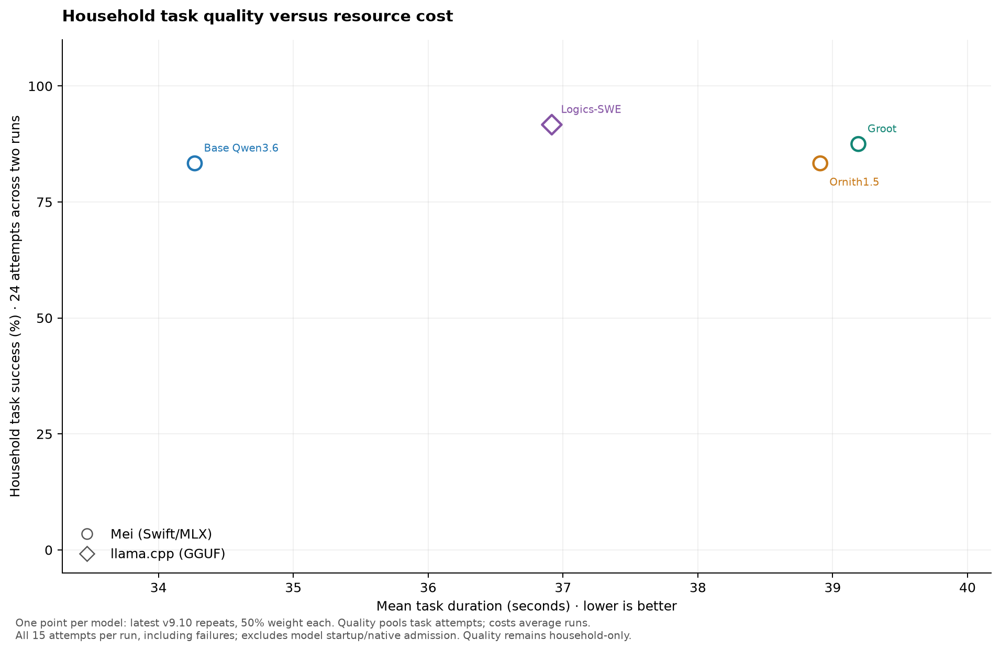
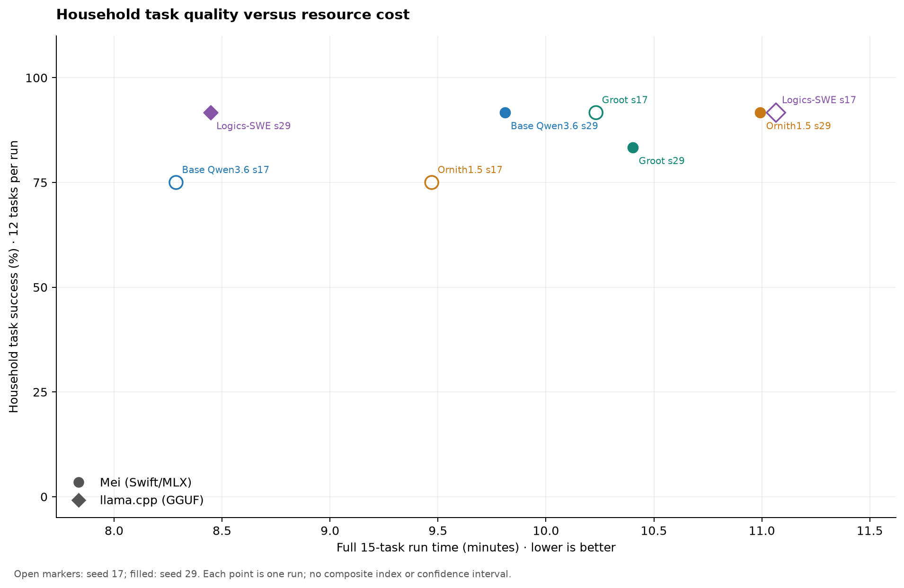
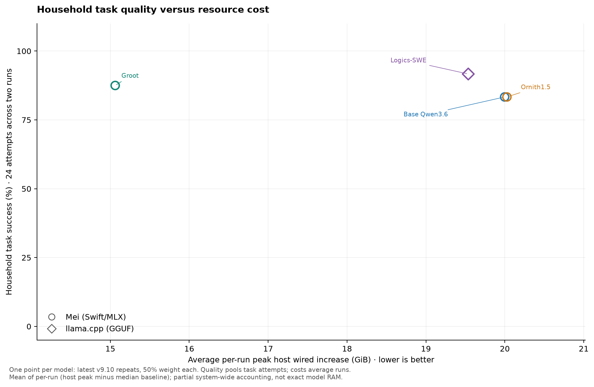

# local-model-bench

Reproducible local LLM benchmarks on affordable Apple Silicon Macs. Compare
agent task quality, full-run time, memory and tool reliability with **Mei
(Swift/MLX)** and **llama.cpp (GGUF)**. Peixinho is the intended future app;
it is still a design, so the current tests use synthetic household workflows
and real, contained Python automation.

Current tooling release: [**benchmark-v9.11.5**](https://github.com/tijs/local-model-bench/releases/tag/benchmark-v9.11.5).
The scored comparison below still uses frozen **benchmark-v9.10**: all eight
measurements predate the latest tooling release. Later releases prepare audited
reporting and context-speed measurements; they do not supply a new scored cohort.

## Four retained contenders

All four ran fresh twice on the same 32 GiB Apple M1 Max, using seeds 17 and 29.
Each run covers 12 household workflows and 3 Python tasks. No older result was
substituted and no best repeat was selected.

| Profile / engine | Household success | Python success | Mean full-run time | Mean peak wired increase |
|---|---:|---:|---:|---:|
| Base Qwen3.6 / Mei (Swift/MLX) | 83.3% (20/24) | 66.7% (4/6) | 9.05 min | 20.00 GiB |
| Ornith1.5 / Mei (Swift/MLX) | 83.3% (20/24) | 66.7% (4/6) | 10.23 min | 20.03 GiB |
| Groot / Mei (Swift/MLX) | 87.5% (21/24) | 100.0% (6/6) | 10.32 min | 15.06 GiB |
| Logics-SWE / llama.cpp (GGUF) | 91.7% (22/24) | 100.0% (6/6) | 9.76 min | 19.54 GiB |

Each graph shows **one weighted-average point per model**, using only its two
complete v9.10 repeats. Equal task coverage gives each run 50% weight; quality
pools passed/attempted tasks separately for household and Python. Raw runs stay
in the linked summary. Time and memory are averaged across the two runs.

Wired increase averages each run’s peak **host wired memory above its median
baseline**: partial, system-wide accounting, not exact model RAM. Background
activity can affect it. Time includes startup, admission and both task tracks;
the separate 30-second baseline is excluded.

[Full summary, exact observations and audit links](results/AGENT_SUMMARY.md) ·
[Interpretation and method](docs/FOUR_MODEL_COMPARISON.md) ·
[Active roster](docs/ROSTER.md)



Mean task duration counts all 15 attempts per run, including failures, then
averages both runs equally. It excludes startup/native admission; read it beside
success rates. The current scored cohort still uses Mei rc.2. Short/long decode
TPS will be shown as connected endpoints once the new runtime's complete,
controlled measurements cover all four profiles.





Logics-SWE reached 11/12 household and 3/3 Python on both trajectories. Groot
used the least observed wired-memory increase and the smallest weight files,
with 10–11/12 household and 3/3 Python. Qwen and Ornith each reached 9–11/12
household; their Python results were 2/3 both runs and 3/3 then 1/3 respectively.
**All four remain contenders.** Two runs do not establish statistical superiority.
Samplers, quantization, model sizes and engines differ; these compare complete
serving profiles, rather than isolating model weights.

Every task attempt completed. All eight supervisors exited normally, all
pressure samples were normal, and swap did not grow. Task failures include
denied private reads, invalid operation IDs, stale-value reuse and exhausted
budgets. Containment holding does not erase an unsafe attempt. No model passed
every household task in these repeats; actual Peixinho acceptance remains open.

## What is tested

- **Household workflows:** capture, ambiguous routing, multipart recovery,
  grounded retrieval, privacy, previewed sharing, copying, saved progress,
  completion intent, routines, outage retry and untrusted content.
- **Python automation:** CSV normalization, decimal-safe expense aggregation and
  reminder-export repair. Models write and run actual scripts. Submitted scripts
  face four contained inputs, including unseen variants; invalid calls still count.
- **Serving behavior:** exact runtime/model identity, health, cache behavior,
  full-run timing and supervised capacity/pressure/swap/disk policy. Short-task
  success does not prove near-64K quality or maximum context capacity.

[Workflow contracts](docs/PEIXINHO_STANDIN.md) ·
[Python tasks and containment](docs/PYTHON_AUTOMATION.md) ·
[Configuration guide](configs/README.md) · [Documentation index](docs/README.md)

## Reproduce a run

Run `uv sync --locked` to install all project dependencies. `pyproject.toml`
and `uv.lock` are canonical; `runner/requirements.txt` is a legacy mirror.
Use the locked Astral environment. Commit a profile with fresh owned runtime,
cache and output paths before a rerun; the published profiles retain the exact
measured choices. Keep one model server at a time and review any partial run
before proceeding.

```sh
uv sync --locked
uv run --locked python -m unittest discover -s runner/tests -v
uv run --locked python runner/supervise_bench.py \
  --config configs/<fresh-committed-profile>.yaml \
  --output artifacts/<fresh-run-id> --trials 1
```

All three MLX profiles use the same distributed
[Mei v0.10.0-rc.2](https://github.com/tijs/mei/releases/tag/v0.10.0-rc.2)
executable and Metal library. Logics-SWE uses its pinned llama.cpp build.
[Exact comparison profiles](configs/four-model-v9p10-20261102/) bind model hashes,
sampling, context, cache, binaries and source revisions.

## Preserved evidence

MiniCPM remains a tested alternative: its latest completed profile passed
**11/12 household and 3/3 Python in 9m38s**, using llama.cpp with CPU8/q8 KV,
no CPU repacking and two recurrent checkpoints. ThinkingCap passed 11/12 and
3/3 in 8m47s. Both results belong to the [earlier v9.5 comparison](results/AGENT_V9.md),
with one trajectory each. Neither has the fresh v9.10 repeats needed for the
current graphs; absence from those graphs is not retirement or a new failed run.
MiniCPM is queued for fresh repeats and short/long-context speed measurements
after Mei stable, followed by inclusion in the current averages and graphs.
Clover remains experimental native Kapitsa/Metal diffusion, separate from Mei.
Flint/JANGH2 and the Hermes runtime are retired; their evidence remains intact.
Do not use automatic config discovery as an active-roster selector.

[Earlier six-model comparison](results/AGENT_V9.md) ·
[Earlier v9.8 repeats](docs/FINALIST_REPEATS.md) ·
[Original v9.9 attempts and grader finding](results/FOUR_MODEL_V9.9_INTERRUPTED.md) ·
[Archived v8.3.1 summary](results/AGENT_SUMMARY_V8.3.1.md) ·
[Release history](docs/releases/)
