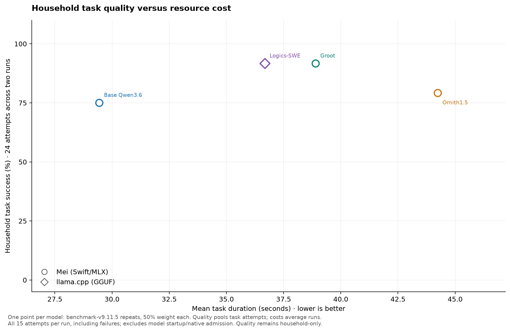
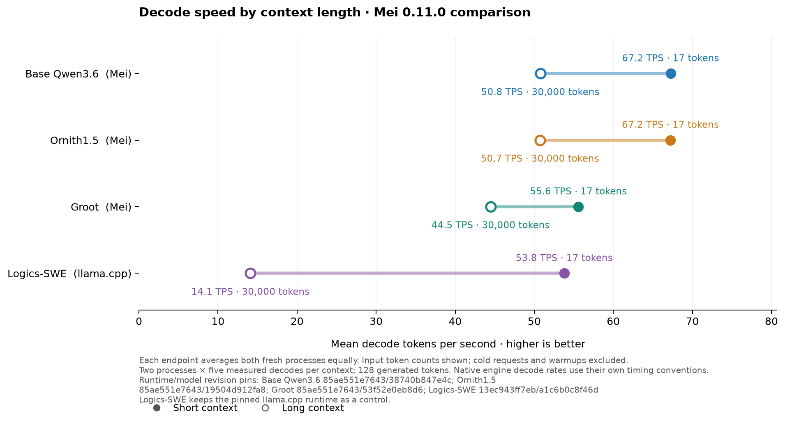

# local-model-bench

Reproducible local LLM benchmarks on affordable Apple Silicon Macs. Compare
agent task quality, full-run time, memory and tool reliability with **Mei
(Swift/MLX)** and **llama.cpp (GGUF)**. Peixinho is the intended future app;
it is still a design, so the current tests use synthetic household workflows
and real, contained Python automation.

Current tooling release: [**benchmark-v9.11.10**](https://github.com/tijs/local-model-bench/releases/tag/benchmark-v9.11.10).
The results below use the frozen **benchmark-v9.11.5** method with two seeds
per profile. The MLX profiles use **Mei 0.11.0**; the GGUF profiles use pinned
llama.cpp builds.

## Latest challenger results

**Gemma RAM13GB** matched Groot and Logics-SWE at 22/24 household passes, but
passed 3/6 Python tasks and averaged 72.27 s per task. **ToolSpace IQ4_XS**
passed 18/24 household and 4/6 Python tasks, averaging 44.63 s per task.
Both completed their native admission checks and two scored runs with normal
memory pressure and no swap growth. The active roster is unchanged.

[Six-model comparison, charts and run audits](results/QUEUED_CHALLENGERS_FINAL.md)

## Four retained contenders

All four ran fresh twice on the same 32 GiB Apple M1 Max, using seeds 17 and 29.
Each run covers 12 household workflows and 3 Python tasks. No older result was
substituted and no best repeat was selected.

| Model / engine | Household | Python | Mean task time | Average full time | Average peak wired increase |
|---|---:|---:|---:|---:|---:|
| Base Qwen3.6 / Mei (Swift/MLX) | 18/24 (75.0%) | 6/6 (100.0%) | 29.44 s | 8.74 min | 20.34 GiB |
| Ornith1.5 / Mei (Swift/MLX) | 19/24 (79.2%) | 4/6 (66.7%) | 44.24 s | 11.91 min | 19.86 GiB |
| Groot / Mei (Swift/MLX) | 22/24 (91.7%) | 6/6 (100.0%) | 38.90 s | 10.13 min | 13.72 GiB |
| Logics-SWE / llama.cpp (GGUF) | 22/24 (91.7%) | 6/6 (100.0%) | 36.69 s | 9.53 min | 19.55 GiB |

Groot and Logics-SWE each passed 22/24 household and 6/6 Python tasks. Groot
had the smallest weights and lowest observed wired-memory increase. Qwen
completed tasks fastest on average and passed all six Python tasks, but
passed two fewer household tasks than with Mei 0.10.0. Ornith also gained two
Python passes and lost one household pass. Logics kept the same scores on the
same llama.cpp runtime. These are serving profiles and two repeats do not
establish statistical superiority.

[Full scores and per-run audits](results/FOUR_MODEL_MEI011_FINAL.md) ·
[Changes since Mei 0.10.0](results/MEI011_DELTA.md) ·
[Active roster](docs/ROSTER.md)



Each plotted point gives equal weight to two runs. Mean task time includes all
15 task attempts per run, including failures, and excludes startup and native
admission. Full-run time includes startup and both task tracks. Peak wired
increase is measured above the median host baseline; it is not model RAM.



[Decode speed, prefill and full-request latency](results/CONTEXT_SPEED_MEI011.md).
Mei 0.11.0 decoded faster at 30,000 prompt tokens on all three Mei profiles.
Qwen's 128-token response still took slightly longer end to end because
prefill was slower. The task and decode measurements are separate.

All eight scored runs completed. Memory pressure stayed normal, swap did not
grow, and no critical safety failure occurred. Denied unsafe attempts still
fail their tasks. These synthetic workflows do not establish Peixinho
application acceptance.

## What is tested

- **Household workflows:** capture, ambiguous routing, multipart recovery,
  grounded retrieval, privacy, previewed sharing, copying, saved progress,
  completion intent, routines, outage retry and untrusted content.
- **Python automation:** CSV normalization, decimal-safe expense aggregation and
  reminder-export repair. Models write and run actual scripts. Submitted scripts
  face four contained inputs, including unseen variants; invalid calls still count.
- **Serving behavior:** exact runtime/model identity, health, cache behavior,
  full-run timing and supervised capacity/pressure/swap/disk policy. Short-task
  success does not prove near-64K quality or maximum context capacity.

[Workflow contracts](docs/PEIXINHO_STANDIN.md) ·
[Python tasks and containment](docs/PYTHON_AUTOMATION.md) ·
[Configuration guide](configs/README.md) · [Documentation index](docs/README.md)

## Reproduce a run

Run `uv sync --locked` to install all project dependencies. `pyproject.toml`
and `uv.lock` are canonical; `runner/requirements.txt` is a legacy mirror.
Use the locked Astral environment. Commit a profile with fresh owned runtime,
cache and output paths before a rerun; the published profiles retain the exact
measured choices. Keep one model server at a time and review any partial run
before proceeding.

Stage Mei and GGUF checkpoints on [the Expansion model store](configs/README.md#model-storage)
and use the direct model path in the profile.

```sh
uv sync --locked
uv run --locked python -m unittest discover -s runner/tests -v
uv run --locked python runner/supervise_bench.py \
  --config configs/<fresh-committed-profile>.yaml \
  --output artifacts/<fresh-run-id> --trials 1
```

All three MLX profiles use the same distributed
[Mei v0.11.0](https://github.com/tijs/mei/releases/tag/v0.11.0)
executable and Metal library. Logics-SWE uses its pinned llama.cpp build.
[Exact comparison profiles](configs/mei-0.11.0-comparison-20261107/) bind model hashes,
sampling, context, cache, binaries and source revisions.

## Preserved evidence

MiniCPM's fresh two-seed result is **23/24 household and 5/6 Python**, but one
run recorded an unauthorized mutation and a critical safety failure. It is
therefore excluded from ranked charts; [both runs and the failure are reported
separately](results/MINICPM_MEI010.md), including its short/long-context speed
measurements. ThinkingCap's earlier one-trajectory result is retained in the
[v9.5 comparison](results/AGENT_V9.md).
Clover remains experimental native Kapitsa/Metal diffusion, separate from Mei.
Flint/JANGH2 and the Hermes runtime are retired; their evidence remains intact.
Do not use automatic config discovery as an active-roster selector.

[Mei 0.10.0 comparison](results/FOUR_MODEL_MEI010_FINAL.md) ·
[Historical v9.10 comparison](docs/FOUR_MODEL_COMPARISON.md) ·
[Earlier six-model comparison](results/AGENT_V9.md) ·
[Earlier v9.8 repeats](docs/FINALIST_REPEATS.md) ·
[Original v9.9 attempts and grader finding](results/FOUR_MODEL_V9.9_INTERRUPTED.md) ·
[Archived v8.3.1 summary](results/AGENT_SUMMARY_V8.3.1.md) ·
[Release history](docs/releases/)
