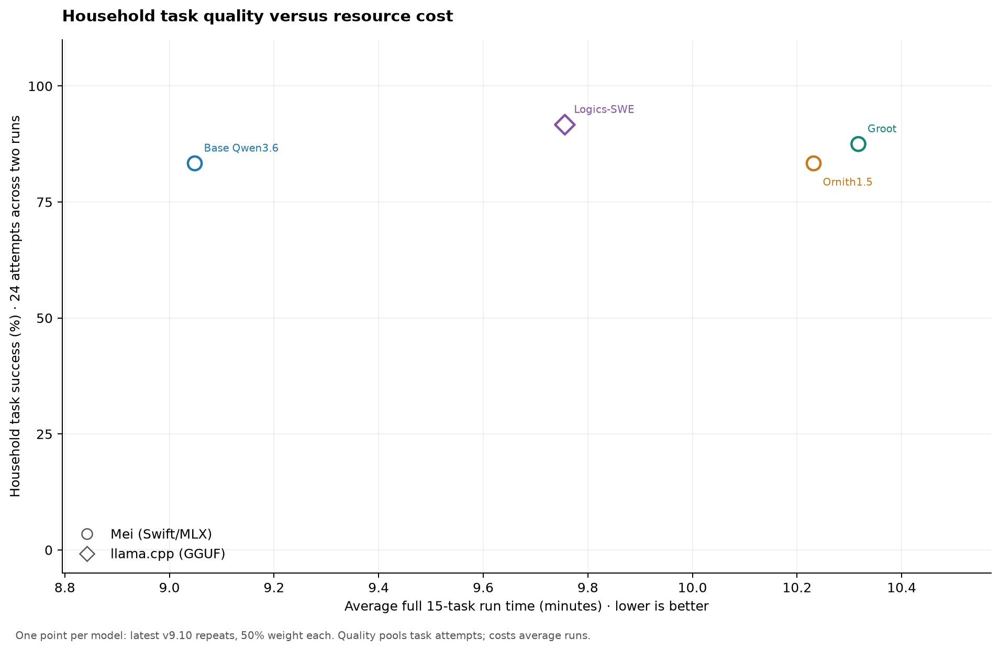
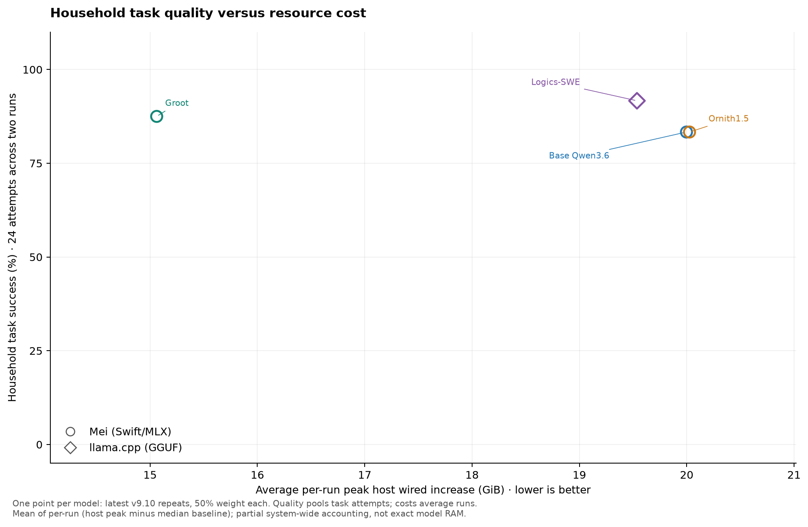
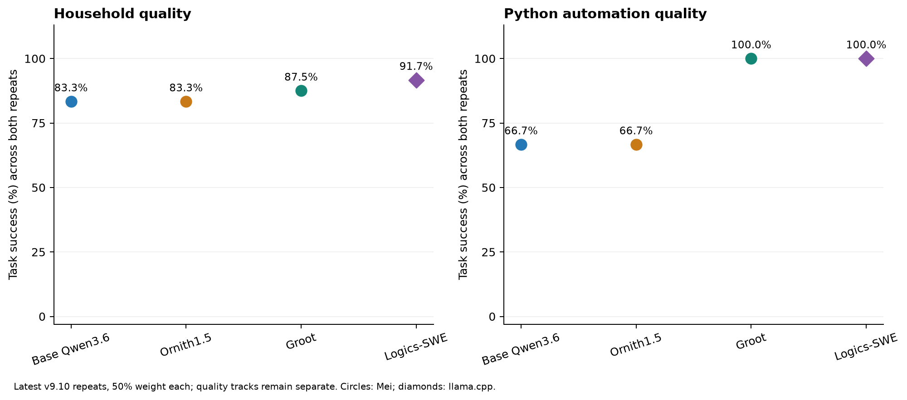

# Four-model local agent comparison

Frozen benchmark **benchmark-v9.10**; two fresh declared seeds per profile, eight complete runs.

All four remain retained contenders. These compare serving profiles, not pure model weights or Peixinho application acceptance.

Each graph shows one weighted-average point per model, using only its two fresh v9.10 repeats. Each run has identical coverage and receives 50% weight. Quality pools task attempts separately for household and Python; time and memory are means across runs. Individual observations remain below.

## Model averages

| Model / engine | Household | Python | Average full time | Average peak wired increase |
|---|---:|---:|---:|---:|
| Base Qwen3.6 / Mei (Swift/MLX) | 20/24 (83.3%) | 4/6 (66.7%) | 9.05 min | 20.00 GiB |
| Ornith1.5 / Mei (Swift/MLX) | 20/24 (83.3%) | 4/6 (66.7%) | 10.23 min | 20.03 GiB |
| Groot / Mei (Swift/MLX) | 21/24 (87.5%) | 6/6 (100.0%) | 10.32 min | 15.06 GiB |
| Logics-SWE / llama.cpp (GGUF) | 22/24 (91.7%) | 6/6 (100.0%) | 9.76 min | 19.54 GiB |

## Individual run evidence

| Model / engine | Seed | Household | Python | Full time | Wired increase (GiB) | Weight storage (GiB) | Audit |
|---|---:|---:|---:|---:|---:|---:|---|
| Base Qwen3.6 / Mei (Swift/MLX) | 17 | 9/12 | 2/3 | 8.29 min | 20.08 | 18.17 | [review](../artifacts/qwen-four-v9p10-seed17-20261102/README.md) |
| Base Qwen3.6 / Mei (Swift/MLX) | 29 | 11/12 | 2/3 | 9.81 min | 19.91 | 18.17 | [review](../artifacts/qwen-four-v9p10-seed29-20261102/README.md) |
| Ornith1.5 / Mei (Swift/MLX) | 17 | 9/12 | 3/3 | 9.47 min | 19.98 | 18.17 | [review](../artifacts/ornith-four-v9p10-seed17-20261102/README.md) |
| Ornith1.5 / Mei (Swift/MLX) | 29 | 11/12 | 1/3 | 10.99 min | 20.07 | 18.17 | [review](../artifacts/ornith-four-v9p10-seed29-20261102/README.md) |
| Groot / Mei (Swift/MLX) | 17 | 11/12 | 3/3 | 10.23 min | 15.08 | 11.45 | [review](../artifacts/groot-four-v9p10-seed17-20261102/README.md) |
| Groot / Mei (Swift/MLX) | 29 | 10/12 | 3/3 | 10.40 min | 15.05 | 11.45 | [review](../artifacts/groot-four-v9p10-seed29-20261102/README.md) |
| Logics-SWE / llama.cpp (GGUF) | 17 | 11/12 | 3/3 | 11.07 min | 19.53 | 18.52 | [review](../artifacts/logics-four-v9p10-seed17-20261102/README.md) |
| Logics-SWE / llama.cpp (GGUF) | 29 | 11/12 | 3/3 | 8.45 min | 19.54 | 18.52 | [review](../artifacts/logics-four-v9p10-seed29-20261102/README.md) |

## Reading the costs and quality

Time includes startup/native admission and both tracks, excluding the separate 30-second baseline. Memory is the peak observed system-wide wired-byte increase over median baseline; background activity can affect it. It is partial accounting, not total model memory. GPU allocations are not reliably captured by process RSS/footprint. Weight storage is separate; no counters are added together.

The graph averages the two per-run peak memory increases; it is not the maximum across both runs. Each repeat has 12 household and 3 Python tasks, so pooled task weighting gives each run 50% weight. All attempts, including failed tasks and missing script submissions, count. There is no weighting by success, response count, tokens, telemetry sample count or duration, and no composite quality score. Two repeats do not establish independence or statistical superiority.

Qwen/Ornith retain their T0.6 sampler; Groot/Logics retain T1 and their declared penalties. Quants, engines and cache settings differ explicitly. No best-run selection or universal winner is implied.

## Provenance and failures

- Seed 17: [validated report](FOUR_MODEL_V9.10_SEED17.md), [exact selection](../results/four-model-v9p10-seed17-20261102.json).
- Seed 29: [validated report](FOUR_MODEL_V9.10_SEED29.md), [exact selection](../results/four-model-v9p10-seed29-20261102.json).

Each per-run review records the frozen grade/tool-journal audit, submitted-script replay and missing submissions. Execution replay is not applicable when no script was submitted. Denied attempts and invalid calls still fail their tasks, even when containment holds or a corrected script later works.

All eight selected supervisors exited normally. The linked cohort reports retain pressure, swap and disk eligibility; each audit retains post-run model/runtime hashes and owned-cache cleanup receipts. These short tasks do not establish near-64K quality or maximum context capacity.

[Interpretation, failed checks and serving profiles](../docs/FOUR_MODEL_COMPARISON.md) · [Original v9.9 attempts](FOUR_MODEL_V9.9_INTERRUPTED.md) · [Historical v8.3.1 summary](AGENT_SUMMARY_V8.3.1.md).
[Metric data](charts/four-model-v9.10/metrics.json) · [CSV](charts/four-model-v9.10/metrics.csv) · [Model averages](charts/four-model-v9.10/model-averages.csv). PNG and SVG exports are kept beside the data.
