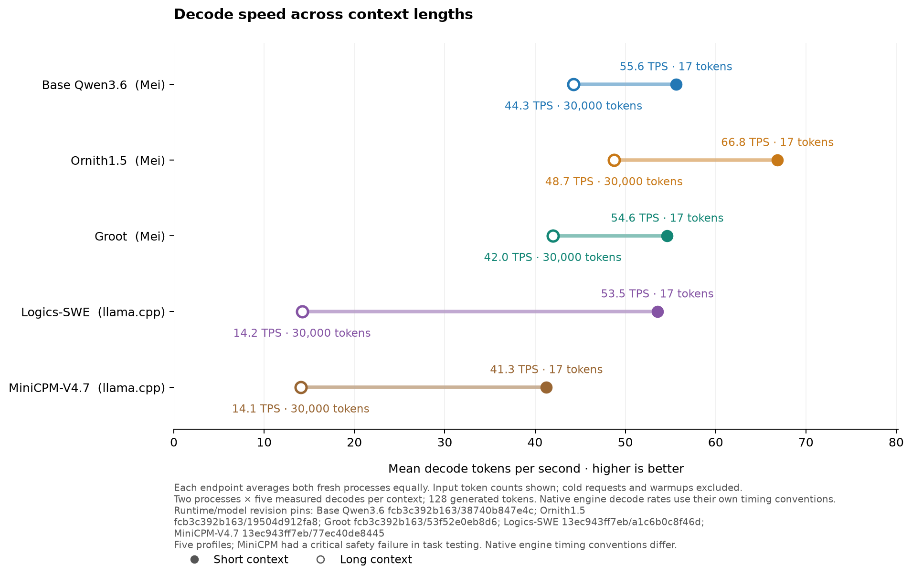

# Decode speed at short and long context

Each endpoint equally averages two independently launched processes, each with five measured greedy 128-token decodes. Cold requests and warmups are excluded. The labels show actual input token counts, and the line connects observations of the same serving profile. Native Mei and llama.cpp timing conventions differ, so this is not a pure model or engine comparison. Task duration and task success are reported separately in the [quality comparison](FOUR_MODEL_MEI010_FINAL.md).

The Qwen, Ornith and Groot timing processes used Mei source commit `b5451a8`; the task runs used stable commit `2018275`. Both have identical Git objects for `Sources`, `Package.swift` and `Package.resolved`, the same vmlx revision and the same executable and Metal library hashes. The combined cohort verifier also checked the declared launch flags, environment and model hashes. This does not prove undeclared inherited environment or identical cross-engine timing conventions. Qwen showed substantial between-process variation during qualification; two processes do not establish a confidence interval.

MiniCPM's speed observations are included, but its [task evidence](MINICPM_MEI010.md) includes a critical safety failure, so it is not a ranked quality point. The speed measurements do not establish quality at 30,000 tokens or maximum-context survival.

[Full observations and pins](charts/five-model-mei010-context-speed.json) · [SVG](charts/five-model-mei010-context-speed.svg) · [Specification](five-model-mei010-context-speed.json) · [Four-profile task/speed identity verification](four-model-mei010-speed-identity.json).
