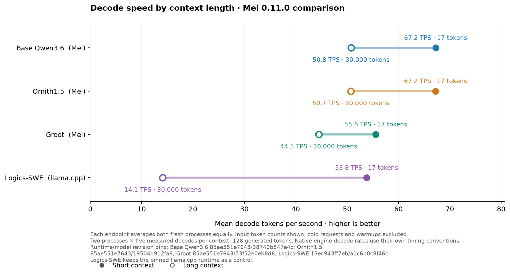
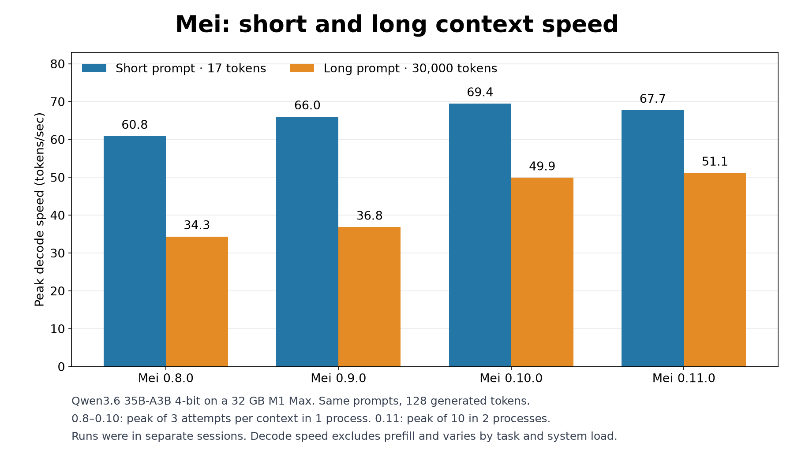

# Decode speed at short and long context

Each endpoint gives equal weight to two fresh processes, each with five
measured greedy 128-token decodes. Cold requests and warmups are excluded.
The lines connect the same model and runtime at two prompt lengths. Mei and
llama.cpp report decode timing differently; these are serving profile
measurements, not a comparison of the engines in isolation.

| Profile | 17 tokens (tok/s) | 30,000 tokens (tok/s) |
|---|---:|---:|
| Base Qwen3.6 / Mei 0.11.0 | 67.2 | 50.8 |
| Ornith1.5 / Mei 0.11.0 | 67.2 | 50.7 |
| Groot / Mei 0.11.0 | 55.6 | 44.5 |
| Logics-SWE / llama.cpp | 53.8 | 14.1 |

In the [release timing audit](../artifacts/mei-upstream-qualification-20261106/attention-selector-final-review-20261107.json),
Mei 0.11.0 decoded faster at 30,000 prompt tokens than 0.10.0 on all three
Mei profiles. The whole request includes prefill and can move differently:

| Mei profile | Decode speed change | Prefill time change | Whole request time change |
|---|---:|---:|---:|
| Base Qwen3.6 | +3.7% | +1.9% | +1.5% |
| Ornith1.5 | +20.3% | −6.9% | −7.1% |
| Groot | +5.6% | −0.3% | −0.6% |

The release audit compared separate run windows. Qwen's slower prefill made
its 128-token response take longer overall despite faster decode. The audit
used non-streaming requests, so it does not measure client time to first
token. A [separate streaming comparison](QWEN_MEI011_STREAMING_TTFT.md) measures
that directly. Logics did not switch runtime and has no Mei-version delta. These tests
do not establish task quality at 30,000 tokens or maximum context capacity.
See the [scored workflows](FOUR_MODEL_MEI011_FINAL.md) for quality and task time.

[All observations and pins](charts/four-model-mei011-context-speed.json) ·
[SVG](charts/four-model-mei011-context-speed.svg) ·
[Specification](four-model-mei011-context-speed.json) ·
[Logics timing audit](../artifacts/mei011-comparison-preparation-20261106/logics-context-controls-review-20261107.json).

## Qwen decode peaks across Mei releases

This updates the earlier Qwen-only release chart. It shows observed peaks on a
32 GB M1 Max, separate from the two-process averages above. All versions used
the same 17- and 30,000-token prompts and generated 128 tokens with no cached
prompt tokens. The older releases had three attempts per context in one
process; the 0.11.0 bars use ten measured attempts per context across two
processes, excluding cold requests and warmups. These runs took place in
separate sessions. Decode speed excludes prefill and is not total response time.

[Original observations](../artifacts/mei-version-speed-20261105/) ·
[0.11.0 release evidence](../artifacts/mei-upstream-qualification-20261106/attention-selector-final-review-20261107.json) ·
[Plot source](../artifacts/mei-version-speed-20261105/plot_release_history.py) ·
[SVG](charts/mei-release-speed-history.svg)
