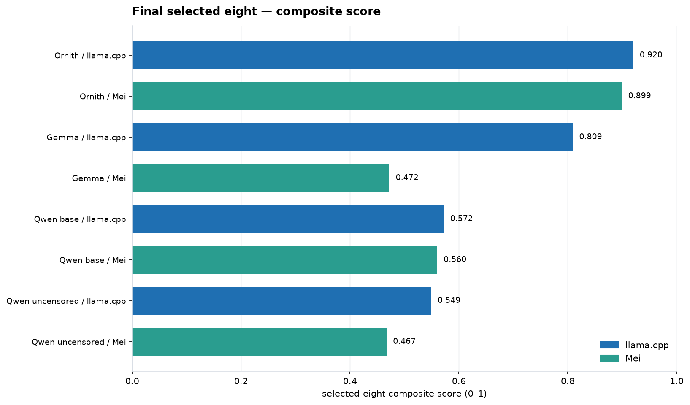
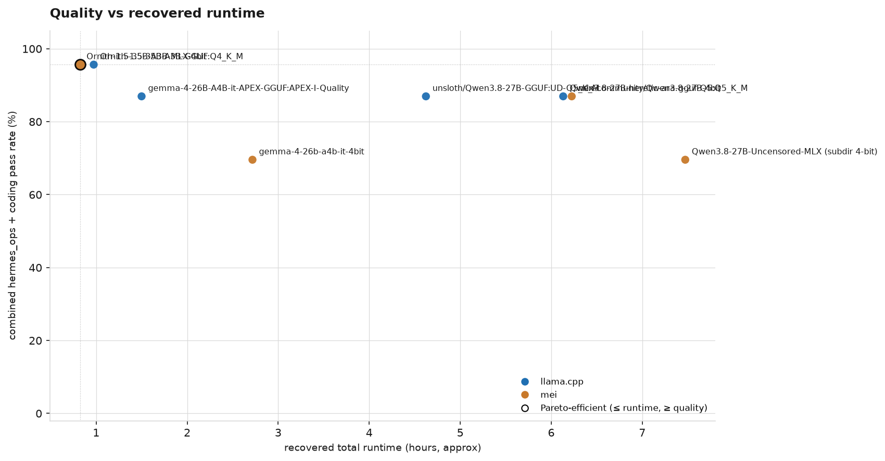
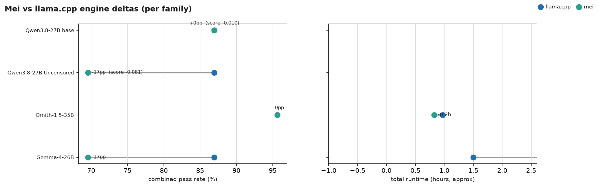
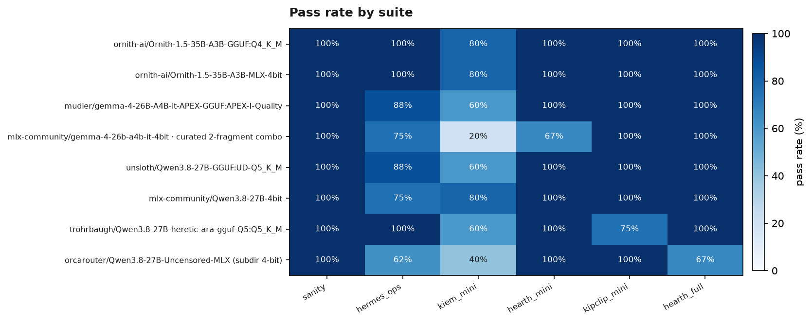
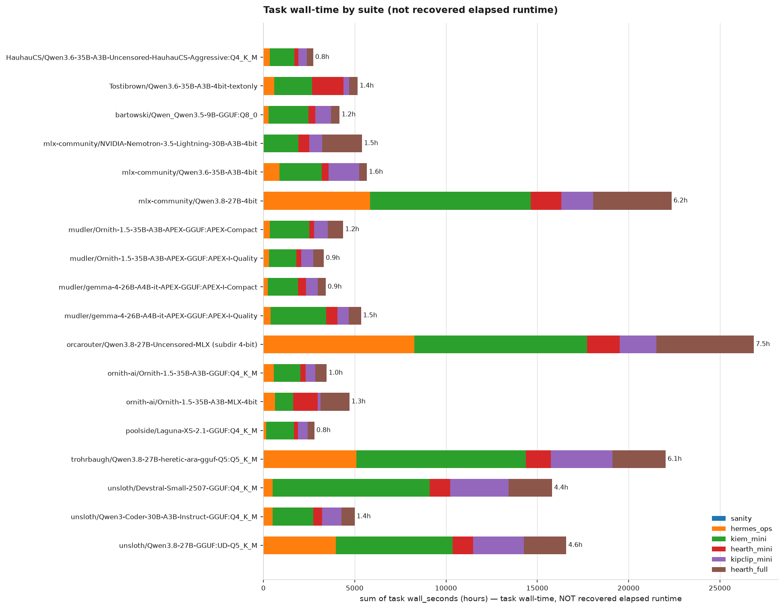
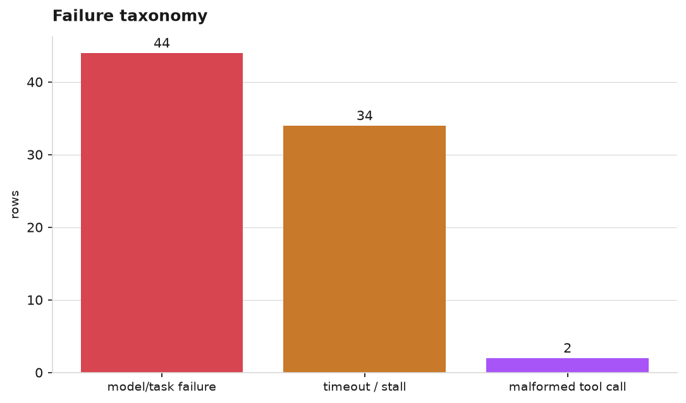
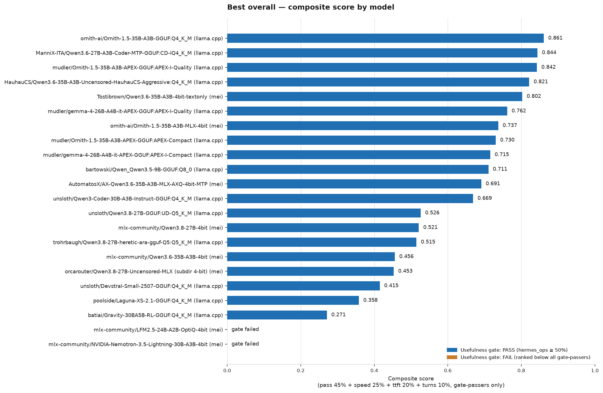

# History

This is the archive of prior findings from this benchmark project, moved
here verbatim on 2026-09-08 when `SUMMARY.md` was restructured to be a
current-state summary. `SUMMARY.md` holds the current picture; this file
holds the superseded sections, findings, and decisions that led there,
in their original words.

---

## Archived charts

These illustrate the 2026-09-06 "Final eight" comparison below and are kept with
it. They are NOT on the summary page: two cannot be regenerated from current
data at all, and the rest describe a model selection that has since changed.

- `engine_delta.png` — Mei vs llama.cpp deltas. **Cannot be regenerated**:
  `build_summary_charts.py` now skips it ("no family had both a pass-rate and
  runtime delta"), because the paired families it compared are no longer both
  in the eligible set.
- `summary_score_chart.png` — the curated "selected eight" composite. Orphaned:
  no current tool regenerates it, and `score_chart.png` supersedes it.
- `failure_taxonomy.png` — three bars totalling every failure row in the log.
  Regenerates, but aggregates across all models and all dates, so it says
  nothing actionable about any single run.
- `quality_vs_runtime.png`, `runtime_breakdown.png` — both regenerate and both
  carry real signal (the dense-model time penalty is stark in the latter:
  Qwen 3.8 variants at 6-7.5 h against Ornith at 1-1.8 h). Kept here rather
  than on the summary because 18-row charts are reference material, not a
  headline.

## 2026-09-07 evening: the three targets re-run on the 0.3.0 build + C1 — no regression, decode faster, quality flat

All three active targets were re-run in one chain (`/tmp/bench_030.sh`, runner
`d2d191e`) with **three things changed at once**: the Mei 0.3.0 build, the C1
flag (`VMLX_ENABLE_UNSAFE_COMPILE=1`), and the runner now clearing the KV
cache dir before each run so every gate row is cold. Single trial, 25 graded
rows each, zero `harness_error` rows.

| model | previous | **0.3.0 + C1** | sanity decode tok/s (basic, tool) | hermes_ops TTFT | coding wall | fails now |
|---|---|---|---|---|---|---|
| Ornith-1.5-35B-A3B (`cef5c7989663`) | 22/25 | **24/25** | 46.8, 28.6 → **51.9, 30.9** | 63.3 → 61.9 s | 49 → 59 min | kiem testwrite (1 mutant survived) |
| Qwen3.6 text-only (`0e7c3d44eade`) | 24/25 | **23/25** | 59.1, 46.5 → **64.6, 50.7** | 63.3 → 61.3 s | 52 → **35 min** | kiem parse-note (Swift compile error), kiem testwrite |
| Qwen3.6 stock (`cfb4a5d79008`) | 22/25 | **21/25** | 44.8, 35.5 → **53.2, 42.6** | 64.5 → 62.9 s | 92 → 104 min | hermes_ops multi-step-chain (40-turn read loop), kiem parse-note, kiem testwrite, hearth_full-feature (hidden test) |

**Read this as "no regression, plausibly better, quality flat."** Every
score moved by 1–2 tasks, which is inside the single-trial swing the text-only
work already measured (bit-identical weights scored 24 vs 22). The two
fails shared by all three (kiem testwrite: 2/3 mutants killed; kiem
parse-note) are the suite's hard tasks, not build regressions. All four
stock-Qwen misses were read before being accepted: the multi-step-chain miss
is a genuine 40-turn `read_file`/`search_files` loop with one hallucinated
tool (`kanban_show`), and hearth_full-feature is a real hidden-test failure
(partial-sell arithmetic).

**What did move for real is decode speed**: the fixed-prompt sanity rows are
+9–19% on every model, consistent with C1's controlled +9.0% (Ornith) and
+9.8% (text-only). hermes_ops TTFT is unchanged at ~61–63 s on all three —
see the prefix-cache finding below.

**Stock Qwen 3.6 is the slow one, again**: 104 min of coding wall against 35
for text-only, with a 29-minute kipclip debug task and a 12-minute kiem
testwrite. It takes the VLM load path (the compiled routed-MoE region is active
there; that region measured −9.7% on Ornith), and it reasons longer. Nothing
in this run argues for keeping stock ahead of text-only for text work.

**Provenance caveat (found 2026-09-07 evening)**: the configs say "vmlx pin
e37d1d59 (0.3.0)", but `runner/start_mei_server.sh` builds from
`~/projects/mei` on `main`, whose `Package.swift` still pins `91fed8be`, and
`mei-build-030/checkouts/vmlx-swift` is at `91fed8be`. So these rows were
served by Mei `main` + vmlx `91fed8be`, not the 0.3.0 release pin. The runs
are internally consistent; the comment is wrong. Fix queued (Kiem proj/mei
note 1191043a).

### The prefix cache is not being used — the biggest lever is unmeasured

Every hermes_ops task sends a byte-identical 20k-token system+tools prefix
(system prompt sha1 `8dcb4e9d`, 41 tools, ~70 KB of JSON), and every task
pays ~61 s of cold prefill for it — in all three runs, despite the persistent
`--kv-cache-dir`. The hybrid cache can only be restored at an anchored
position, and the runner never passes Mei's existing (default-off)
`--ssm-anchor-boundaries K` flag. In the coding suites that is ~60 s per task
of the 35–104 min wall. Probe queued (`results-mei/C3-harness/anchor_probe.py`).

## 2026-09-07 update: text-only Qwen 3.6 is the new top pick; Nemotron discarded

Two overnight full benchmark runs. Both are single-trial, 25 graded rows each
(2 sanity, 8 `hermes_ops`, 15 coding), zero `harness_error` rows.

| model | sanity | hermes_ops | coding | **total** |
|---|---|---|---|---|
| **Tostibrown/Qwen3.6-35B-A3B-4bit-textonly** (`3421f91401ab`) | 2/2 | **8/8** | 14/15 | **24/25** |
| ornith-ai/Ornith-1.5-35B-A3B-MLX-4bit (`dc3e7e62a965`) | 2/2 | 6/8 | 14/15 | 22/25 |
| mlx-community/Qwen3.8-27B-4bit (`c7f10a958b1e`) | 2/2 | 6/8 | 14/15 | 22/25 |
| mlx-community/Qwen3.6-35B-A3B-4bit (stock, `cea524483faf`) | 2/2 | 7/8 | 13/15 | 22/25 |
| orcarouter/Qwen3.8-27B-Uncensored-MLX (`40fbffd03a95`) | 4/4 | 5/8 | 11/15 | 20/27 |
| mlx-community/gemma-4-26b-a4b-it-4bit (`bc93f3cc55a1`) | 2/2 | 6/8 | 10/15 | 18/25 |
| ~~NVIDIA-Nemotron-3.5-Lightning-30B-A3B~~ **DISCARDED** (`d9be6d0097ea`) | 2/2 | 1/8 | 4/15 | 7/25 |

### What the text-only build is

A Mei-produced derivative of `mlx-community/Qwen3.6-35B-A3B-4bit` with the
vision tower removed: 333 `vision_tower` tensors (851.8 MiB) and the
`vision_config` key stripped. **Every retained tensor is byte-identical to the
source** (per-tensor sha256 verified at build time, re-verified on a 50-tensor
random sample). Published at
<https://huggingface.co/Tostibrown/Qwen3.6-35B-A3B-4bit-textonly>; config at
`configs/Qwen3.6-35B-A3B-textonly/mei.yaml`.

Measured against stock, both runs **cold** (hermes_ops TTFT 62–66 s on both
sides, separate KV directories, each a first run):

- **Memory**: 19.551 GB loaded vs 20.444 GB — **−0.83 GiB**, exactly the vision tower.
- **Short decode**: 1.31–1.32x faster on the sanity rows (fixed prompt,
  near-fixed output), consistent with the isolated 61.85 vs 49.95 tok/s
  measurement. Removing `vision_config` also moves the bundle from vmlx's VLM
  load path to the LLM path, which is where the speed difference comes from.
- **Quality: unchanged.** The 24/25 vs 22/25 gap **is not a real difference** —
  the text weights are bit-identical, so it cannot be. It is single-trial
  variance, and a useful calibration of it: an 8-point swing at temperature 0.

**Recommendation: make text-only Qwen 3.6 the primary Mei candidate.** Top
score, lowest memory, fastest short decode, fully reproducible provenance.
Keep the stock config for history; run the text-only one.

### Nemotron-3.5-Lightning: discarded 2026-09-07

Scored **7/25** (hermes_ops 1/8). **Speed is not why.** Its decode is ~68–70
tok/s, the fastest in the Mei lineup. It fails because it does not emit tool
calls when the prompt carries Hermes's ~22k-token tool payload — it narrates
the intended call in prose and stops, so every task ends after one turn.

Ruled out with live evidence: chat template (the real 4,739-token Hermes system
prompt alone produces a valid call), tool count (22 tools fine), thinking mode
(`--enable-thinking false` gives byte-identical failures), raw prompt length
(6.3k tokens of repeated filler still works), and an explicit "you must call
tools" instruction. With realistic varied context the threshold is ~5–6k tokens.
Config marked `viable: non-viable`. Only untested lever: shrink the tool payload.

### Harness defect found — the speed gate is not reproducible

Nemotron was run twice against the **same persistent `--kv-cache-dir`**. Same
prompts, byte-identical outputs, and:

| run | avg hermes_ops tok/s | avg TTFT | 4.0 speed gate |
|---|---|---|---|
| first (cold KV cache) | **1.02** | 84.6 s | **failed** → coding skipped |
| second (warm from run 1) | **32.74** | 1.8 s | **passed** → coding ran |

`tokens_per_second = completion_tokens / wall_seconds` and this workload is
~99% prefill, so the metric moves **32x on cache state alone**. Every Mei config
uses a persistent KV dir, so this can affect any cross-run comparison.
**It did not corrupt the table above** — both Qwen 3.6 runs were verified cold.
Suggested fix: clear the KV dir before a gated run, or record cache state on the
gate row so cold and warm are never compared.

### Note on memory figures elsewhere in this file

`mei_memory_active_bytes` / `peak` are **MLX allocator** numbers, not OS memory
pressure. Measured 2026-09-07: a 19.5 GB mmap'd model shows only ~150 MB
`phys_footprint` and ~1.1 GB RSS, because the weights are clean file-backed
pages. Treat "peak 25.73 GB @ 65k"-style figures as allocator accounting.

## Final eight: post-fix local comparison

Each headline entry has **25 graded rows**: 2 sanity, 8 `hermes_ops`, and
15 coding tasks. The Gemma/Mei entry combines two explicitly pinned fragments
with the same model/config (10 sanity+Hermes rows plus 15 coding rows). All
eight have zero `harness_error` rows. The selected-eight score is a report
score, normalized only across these eight entries: 45% combined quality, 25%
decode speed, 20% recovered total runtime, 10% coding turns. Decode tok/s and
TTFT are model-speed metrics; coding token counts and wall/runtime are
end-to-end agent-task metrics.

| Family | Engine / selected artifact | Sanity | Hermes Ops | Coding | Combined | Decode tok/s | TTFT (s) | Runtime | Sanity+Hermes tokens in/out | Coding tokens in/out | Score |
|---|---|---:|---:|---:|---:|---:|---:|---:|---:|---:|---:|
| Ornith-1.5-35B | llama.cpp / Q4_K_M | 2/2 | 8/8 | 14/15 | **95.7%** | **30.0** | 7.0 | 0.97 h | 1,991,913 / 18,763 | 236,585 / 91,269 | **0.920** |
| Ornith-1.5-35B | Mei / MLX 4-bit | 2/2 | 8/8 | 14/15 | **95.7%** | 20.8 | 39.1 | **0.82 h** | 1,051,258 / 8,890 | 206,471 / 56,449 | **0.899** |
| Gemma 4 26B A4B | llama.cpp / APEX-I-Quality | 2/2 | 7/8 | 13/15 | **87.0%** | **29.9** | 10.7 | 1.50 h | 1,376,408 / 10,779 | 321,682 / 108,123 | **0.809** |
| Gemma 4 26B A4B | Mei / MLX 4-bit | 2/2 | 6/8 | 10/15 | **69.6%** | 4.2 | 53.6 | 2.72 h | 429,756 / 1,374 | 357,740 / 97,174 | **0.472** |
| Qwen3.8-27B base | llama.cpp / UD-Q5_K_M | 2/2 | 7/8 | 13/15 | **87.0%** | 6.7 | 46.6 | 4.62 h | 1,658,201 / 29,555 | 257,730 / 77,054 | **0.572** |
| Qwen3.8-27B base | Mei / MLX 4-bit | 2/2 | 6/8 | 14/15 | **87.0%** | 5.1 | 294.0 | 6.23 h | 1,700,331 / 32,270 | 265,176 / 101,695 | **0.560** |
| Qwen3.8-27B Uncensored | llama.cpp / Heretic Q5_K_M | 2/2 | 8/8 | 12/15 | **87.0%** | 6.5 | 49.9 | 6.13 h | 1,551,927 / 36,479 | 249,028 / 82,317 | **0.549** |
| Qwen3.8-27B Uncensored | Mei / MLX 4-bit | 2/2 | 5/8 | 11/15 | **69.6%** | 6.6 | 304.5 | 7.47 h | 3,557,407 / 53,478 | 173,362 / 46,915 | **0.467** |

### Outcome summary

- **Best overall quality:** Ornith reaches 95.7% on both engines. llama.cpp has
  the higher decode rate (30.0 vs 20.8 tok/s); Mei completes the recovered
  benchmark interval sooner (0.82 vs 0.97 h).
- **Gemma:** the llama.cpp APEX-I-Quality artifact is materially ahead of its
  Mei counterpart on quality (87.0% vs 69.6%), decode speed (29.9 vs 4.2
  tok/s), and recovered runtime (1.50 vs 2.72 h).
- **Qwen base:** quality is tied at 87.0%; llama.cpp is faster on decode and
  recovered runtime, while Mei has one more coding pass (14/15 vs 13/15).
- **Qwen Uncensored:** llama.cpp has higher quality (87.0% vs 69.6%) and is
  faster end-to-end; decode speed is effectively tied (6.5 vs 6.6 tok/s).
- **Failure taxonomy:** 28 model/task failures across the selected rows: 12
  task failures and 16 timeout/stall classifications; 0 malformed-tool and
  0 harness errors. See `failure_taxonomy.png`.
- **Not a universal engine win:** this final set supports a clear llama.cpp
  recommendation for Gemma and Qwen, while Mei remains competitive on
  Ornith quality and elapsed runtime.

### Final eight charts

## Benchmark-v4 (2026-09-01): the hermes_ops real-answer fix, and the current active lineup

**What changed and why**: hermes_ops's one-shot `run_prompt.py` client had
no `finish_reason=length` continuation logic (unlike the coding suites'
real `hermes chat` agentic loop), so thinking-mode models were getting
truncated mid-answer at the default 4096-token cap — an artificial
ceiling, not a real capability gap. Fixed with a per-config
`hermes_ops_max_tokens` override (16384 for thinking-mode configs).
Raising the cap exposed a SECOND, previously-masked bug: `run_prompt.py`
never counted `reasoning_content` deltas as stream progress, so a
thinking model reasoning past the first_progress/stream_idle watchdogs
got misclassified as stalled even while actively generating — fixed by
counting `reasoning_content` as meaningful progress. Both fixes verified
live against the Heretic config, which reproduced both failures in
sequence as each landed (`hermes_ops-targeted-edit`: FAIL/truncation →
FAIL/stall → PASS). See git tag `benchmark-v4` and commit `0adb046` for
the full technical writeup.

**Full rerun results** (all under the new methodology, hermes_ops now
correctly measuring real capability instead of an artificial token
ceiling):

| Model | Sanity | hermes_ops | Coding | avg tok/s | hermes_ops tokens (prompt/completion) | Coding tokens (in/out) |
|---|---|---|---|---|---|---|
| Ornith-1.5-35B-A3B Q4_K_M (baseline, no thinking) | 2/2 | 8/8 | 14/15 | **29.4** | 1,665,372 / 10,698 | 229,237 / 84,413 |
| Qwen3.8-27B UD-Q5_K_M | 2/2 | 8/8 | 14/15 | 6.7 | 1,657,256 / 31,027 | 244,885 / 75,237 |
| Qwen3.8-27B-Uncensored (Heretic) Q5_K_M | 2/2 | 8/8 | 12/15 | 6.4 | 1,550,982 / 36,334 | 249,028 / 82,317 |
| Gemma 4 26B-A4B APEX-I-Quality | 2/2 | 7/8 | 13/15 | 28.1 | 1,376,115 / 10,609 | 321,682 / 108,123 |
| Qwen3.6-35B-A3B-Uncensored Q4_K_M | 2/2 | 6/8 | 13/15 | 27.1 | 2,194,585 / 9,395 | 341,649 / 61,240 |
| Ornith-1.5-35B-A3B Q5_K_M | **CRASHED (OOM)** | — | — | — | — | — |
| Ornith-1.5-35B-A3B APEX-I-Quality | 2/2 | 7/8 | 14/15 | 27.4 | 1,875,678 / 7,693 | 324,217 / 82,559 |
| Ornith-1.5-35B-A3B "thinking" attempt | 2/2 | 8/8 | 14/15 | 28.7 | 1,990,968 / 18,631 | 236,585 / 91,269 |

**Two findings worth flagging on their own**:

1. **Ornith Q5_K_M crashed on a genuine GPU/unified-memory OOM during
   model warmup** (`kIOGPUCommandBufferCallbackErrorOutOfMemory`, real
   Metal error, SIGABRT) — not a benchmark or config bug. The header
   comment's own estimate (~26.9GB, comfortably under 32GB) was too
   optimistic: real llama.cpp compute-buffer overhead costs more than
   weights+KV arithmetic accounts for. Confirmed not transient: the very
   next config (a *smaller* 21.25GB quant) launched and ran cleanly
   seconds later, same machine, same code path. Marked `viable: blocked`
   in `configs/Ornith-1.5-35B-A3B/gguf-q5.yaml`.
2. **The Ornith "thinking mode" fix attempt did not work.** Ornith 1.5 is
   genuinely built on the Qwen 3.5 MoE lineage and IS a reasoning model
   by design (confirmed via its own `config.json` and README), but every
   existing config launches its server without `--jinja`, silently
   falling back to llama.cpp's generic template instead of the model's
   real one — meaning every prior Ornith result in this benchmark ran
   without its native thinking behavior. Adding `--jinja` plus the same
   effort-aware template already used for the Qwen3.8-27B family DID load
   and run cleanly (8/8 hermes_ops, 14/15 coding) — but a direct
   transcript check across all 8 hermes_ops tasks found **zero
   `reasoning_content`, zero `<think>` tags** anywhere. Something about
   this template/model combination isn't actually activating visible
   reasoning, despite loading without error. **This needs real diagnosis
   before it's worth re-running** — the current config
   (`gguf-thinking.yaml`) doesn't demonstrate thinking mode actually
   works, it just demonstrates it doesn't crash.

**Pruning decision (user call, 2026-09-01)** — active lineup going
forward:
- **Keep**: Ornith Q4_K_M (baseline — best plain result, fastest,
  cleanest sweep), Qwen3.8-27B UD-Q5_K_M, Gemma 4 I-Quality.
- **Keep deliberately despite the lower score**: Qwen3.8-27B-Uncensored
  (Heretic) — kept specifically to have an uncensored option
  represented in the lineup, even though its speed (6.4 tok/s) and
  coding rate (80%) are near the bottom of this batch.
- **Dropped** (real, viable results — not marked non-viable, just not
  carried forward): Qwen3.6-35B-A3B-Uncensored, Ornith
  APEX-I-Quality.
- **Excluded — too large for this hardware, not a fixable bug**: Ornith
  Q5_K_M. This isn't "blocked pending a fix and worth retrying later" —
  the quant itself (23.6GB) doesn't fit this Mac's usable memory margin,
  a permanent size constraint on this specific hardware, not a transient
  or software issue.
- **Open, not re-queued**: Ornith "thinking mode" — needs the
  reasoning-activation gap above actually diagnosed first.

**Benchmark v2, in one paragraph**: two real methodology bugs were found
and fixed this round — a shared Swift fixture bug (`kiem_mini-parse-note`
failing on toolchain-agnostic grounds, not model capability — see
"Harness fixes" below) and coding-suite timeouts too tight to let a
slower-but-correct model finish (1500s → 3000s). The leaderboard's "Best
overall" ranking also moved from a hard pass/fail gate to a weighted
composite score (pass rate 45%, speed 25%, time 20%, turns 10%) so a
slow-but-correct model scores lower rather than being disqualified
outright. 10 of this benchmark's already-tested models were rerun end to
end under the fixed methodology, plus 4 new candidates added mid-session
(a reasoning-effort variant, a rebuilt-toolchain Laguna retest, and two
Ornith requant variants) — 14 configs total (one, an MTP variant, was
deliberately skipped — see below).

**Auto-table eligibility, tightened 2026-08-29**: `LEADERBOARD.md`'s "Best
overall" table now requires a group to have run the FULL suite on both
hermes_ops (8 tasks) and coding (11 tasks) — not just "at least one row
of each" — and to be graded under `benchmark-v2` or a later commit, not
pre-v2 methodology. This closed two real gaps found the same day: a
1-coding-task partial rerun had been ranking #1 over
`APEX-Compact`'s genuine 11/11 result on raw pass-rate alone, and a
dedup bug was silently erasing a model (Luna, via OpenRouter) from the
table entirely because the evidence-richest fragment happened to be
missing its sanity row — dedup now prefers a complete fragment over an
incomplete-but-richer one, not just the most evidence. Regenerating with
these fixes shrank the table from 31 rows to 8 and changed the top
ranking materially (see below).

**Still an open gap, not fixed by the above**: a model with NO single
`runner_git_sha` fragment that's complete on its own — only several
complementary partial ones (e.g. one fragment has full coding but no
sanity row, another has sanity but only partial coding) — still won't
appear, because merging evidence across fragments graded by different
harness code risks blending incompatible grading semantics. The
Qwen3.8-27B xhigh-effort row is exactly this case; its real data is
reconciled by hand below since the auto-table can't safely show it.

**"Pass rate" now means hermes_ops + coding combined, not coding alone**
(fixed same day, user request): `Laguna-XS-2.1` had briefly ranked #1 in
the auto-table (0.914) ahead of `APEX-Compact` (0.901) purely on
speed/time, because hermes_ops was only ever a pass/fail gate (≥50%) and
never affected score once past it — a bare 50% hermes_ops record scored
identically to a clean 100% sweep. The "pass" axis of the composite now
counts every hermes_ops AND coding task as one equal unit toward a single
combined rate, so a barely-gate-passing record costs real score even with
a speed/time edge. Regenerating: `APEX-Compact` is back to #1 (0.901),
`Laguna-XS-2.1` #2 (0.837) — matching this doc's actual recommendation
without needing a hand-curated caveat about the chart's top row. The
≥50% hermes_ops gate itself is unchanged; this only changed what happens
to score *above* it.

**Chart below is current as of benchmark-v4 (2026-09-01)**: the
benchmark-v4 rerun (see above) ran the 8-model lineup against the full
15-task coding suite (`hearth_full` included), so `LEADERBOARD.md`'s
"Best overall" table and this chart now reflect real v4 data — no longer
stale. Note the leaderboard's dedup logic keeps only one config per
model+engine+quant triple: `ornith-ai/Ornith-1.5-35B-A3B-GGUF:Q4_K_M`
appears ONCE in that table (the more recent "thinking mode" attempt's
config_hash), silently superseding the plain baseline row even though
both are legitimate, differently-configured results — see the
benchmark-v4 section above for why that specific row's "reasoning:
thinking (medium)" label doesn't reflect actually-observed behavior.

*Composite score = combined hermes_ops+coding pass rate 45% + speed 25% +*
*time taken 20% + turns used 10%, gate-passers only (hermes_ops ≥ 50%) —*
*see `LEADERBOARD.md`'s "Best overall" table for the exact per-model*
*numbers behind this chart.*
*Auto-regenerated by `runner/plot_leaderboard.py` after every benchmark*
*run; this image can go stale between SUMMARY.md's own hand-curated edits.*

## New standout: Ornith-1.5-35B-A3B on a third-party APEX quant

**`mudler/Ornith-1.5-35B-A3B-APEX-GGUF:APEX-Compact`** — a third-party
mixed-precision quant (routed experts at lower precision since only 8 of
256 fire per token, always-active components kept high precision) —
landed a **perfect score**: hermes_ops **8/8**, coding **11/11**, at
28.6 tok/s. This genuinely beats the standard Q4_K_M baseline below (91%
coding, 100% hermes_ops) on coding pass rate specifically, at a smaller
file size (16.5GB vs Q4_K_M's ~21GB) and comparable speed. This is now
the clearest pick in the whole dataset if you're willing to use a
third-party quant rather than the model author's own.

A parallel run of the same technique bundled with MTP speculative
decoding (`APEX-MTP-Compact`) was deliberately **not run** — the user
chose to isolate APEX's quantization effect alone rather than re-test MTP
speculative decoding on this model, given this repo's existing negative
MTP result on a different model (Qwen3.8-27B, see "retired configs"
below). Whether MTP would help *this* model specifically remains
untested.

Config: `configs/Ornith-1.5-35B-A3B/gguf-apex.yaml`.

## The three-way tie on coding pass rate — pick by speed, then hermes_ops (author's-own-quant baseline)

Among models on their original author's own quant (not the third-party
APEX requant above), these three all landed **91% coding** (10/11 tasks)
on the full 11-task battery — the highest coding pass rate in that group.
Speed and hermes_ops reliability are what separate them:

| Model | Engine | hermes_ops | coding | avg tok/s |
|---|---|---|---|---|
| **Ornith-1.5-35B-A3B** (Q4_K_M) | llama.cpp | **100%** (8/8) | 91% (10/11) | **30.9** |
| Qwen3.6-35B-A3B-Uncensored (Q4_K_M) | llama.cpp | 75% (6/8) | 91% (10/11) | 30.2 |
| Qwen3.8-27B (UD-Q5_K_M, 64K ctx) | llama.cpp | 88% (7/8) | 91% (10/11) | 6.8 |

**Pick: `Ornith-1.5-35B-A3B` on `llama.cpp`.** It's the only one of the
three with a clean hermes_ops sweep (8/8 — no dropped tool-calling/agent-
op task), and it ties the other two on coding while running ~4.5x faster
than the Q5_K_M Qwen3.8-27B variant. `Qwen3.6-35B-A3B-Uncensored` is a
close, genuinely comparable second choice — same coding rate, same speed
tier, just two hermes_ops misses (`error-recovery`, `persistent-failure`)
Ornith didn't have.

Config: `configs/Ornith-1.5-35B-A3B/gguf.yaml`. First attempt at testing
this hit a false "backend never became healthy" report (~17.5min cold-
cache load exceeding the harness's old 600s health-check timeout) —
confirmed healthy via the server log and a live curl, recovered with a
plain relaunch. This exact incident is why the timeout was raised to 1800s
(see "Harness fixes" below) — worth knowing if you re-run this config and
the first load looks slow.

## Qwen3-Coder-30B-A3B — a second perfect coding score, on the standard quant

`unsloth/Qwen3-Coder-30B-A3B-Instruct-GGUF:Q4_K_M` scored **coding 11/11**
under benchmark v2's rerun (up from a much weaker earlier result under
the pre-v2 methodology) — hermes_ops landed at 75% (6/8, missing
`multi-step-chain` and `no-tool-needed`). This is a standard-architecture
dense-GQA MoE model (confirmed via its HF `config.json`: `qwen3_moe`, no
hybrid/linear-attention layers) — notably, this is also the model used to
rule out "hybrid architecture is the whole explanation" in the ongoing
MLX-slowdown investigation (see that section below), since it showed the
same MLX slowdown pattern despite having no hybrid layers.

Config: `configs/Qwen3-Coder-30B-A3B/gguf.yaml`.

## Qwen3.8-27B family: quant and reasoning-effort tradeoffs, not a clean story

This session tested the base and Uncensored Qwen3.8-27B checkpoints at
both Q4_K_M and UD-Q5_K_M, plus a "quality-max" variant (min-p=0.0,
reasoning-effort=xhigh) of the base Q5 config. The results do **not**
point to a single simple rule:

| Variant | hermes_ops | coding | Note |
|---|---|---|---|
| base, Q4_K_M | 8/8 (100%) | 9/11 (82%) | |
| base, UD-Q5_K_M | 7/8 (88%) | **10/11 (91%)** | Q5 beat Q4 here |
| base, UD-Q5_K_M + xhigh effort | **8/8 (100%)** | 9/11 (82%) | see below |
| Uncensored, Q4_K_M | 8/8 (100%) | 10/11 (91%) | |
| Uncensored, Q5_K_M | 5/8 (62%) | 10/11 (91%) | Q5 regressed hermes_ops here |

**Quant-up doesn't uniformly help**: Q5 beat Q4 on the base model
(coding 82%→91%), but on the Uncensored fine-tune, Q5 *regressed*
hermes_ops (100%→62%) for the same coding pass rate — a real,
checkpoint-specific finding, not a general rule for this family.

**Reasoning-effort xhigh is a genuine mixed tradeoff, not a clean win**:
explicitly setting `--reasoning-effort xhigh` (overriding the chat
template's silent `medium` default every other result on this family
used) took hermes_ops from 7/8 to a perfect 8/8, but coding actually
*dropped* from 10/11 to 9/11 (two tasks config 4 passed — `kiem_mini-
parse-note` and `kipclip_mini-testwrite` — failed under xhigh). The cost
was steep: individual coding tasks ran roughly **1.8x longer** in
wall-clock time (e.g. one hermes_ops task went from 1506s to 2696s) at
essentially unchanged raw decode speed (~6-7 tok/s either way) — the
difference is entirely more reasoning tokens generated per turn, not
slower generation. Verdict: xhigh trades a coding regression for a
hermes_ops improvement at a steep time cost — not a straightforward
"more effort = better" result, and not clearly worth the wall-clock cost
for this benchmark's task mix.

Also discovered (and fixed, not just measured) during this investigation:
`--min-p` silently defaults to `0.05` in llama.cpp, not `0.0`/disabled as
Qwen's own sampler recipe specifies — see
[`docs/INFERENCE_ENGINES.md`](../docs/INFERENCE_ENGINES.md) for the full
gotcha. Every prior Qwen3.8-27B result on record ran with this filter
active without anyone having set it explicitly. The xhigh config fixes
this too, so its coding/hermes_ops numbers reflect BOTH changes
together, not reasoning effort in isolation.

Configs: `configs/Qwen3.8-27B/gguf.yaml`, `gguf-unsloth-ud-q5-64k.yaml`,
`gguf-unsloth-ud-q5-64k-xhigh.yaml`, `configs/Qwen3.8-27B-Uncensored/
gguf.yaml`, `gguf-q5.yaml`.

## Next tier — 73-82% coding

| Model | Engine | hermes_ops | coding | avg tok/s |
|---|---|---|---|---|
| Muse-Glimmer-30B (Q4_K_M) | llama.cpp | 62% (5/8) | 82% (9/11) | 8.5 |
| Devstral-Small-2507 (Q4_K_M) | llama.cpp | 75% (6/8) | 73% (8/11) | 7.7 |
| Qwen3.5-9B (Q8_0) | llama.cpp | 75% (6/8) | 64% (7/11) | 20.9 |

Muse-Glimmer is genuinely capable, held back mostly by speed (~8.5 tok/s)
and a rockier hermes_ops sweep (3 misses: `chaining`, `noisy-result`,
`multi-step-chain`) rather than coding correctness — every coding fail on
record is a real, on-topic wrong answer, not a harness artifact.
Qwen3.5-9B is the smallest model tested this session (9B vs 27-35B for
everything else) and scores accordingly — a real, expected
size-vs-capability tradeoff, not a surprise.

## Fast, but doesn't do agentic coding — a real, repeated finding

Every `LiquidAI/LFM2.5-8B-A1B` variant tested (GGUF Q8_0, GGUF BF16, MLX,
vllm-mlx, and two DSpark/speculative-decoding attempts) scored **0/11 or
1/11 on the coding suite** despite being the fastest models in the whole
benchmark (55-68 tok/s). This isn't an infra artifact — confirmed via
`hermes_turns`/`hermes_tool_calls` being populated (real, if weak, model
output) on every attempt, not the null/missing pattern that flags a
harness crash. The smaller `LiquidAI/LFM2.5-2.6B` (Q8_0) does somewhat
better (36%, 4/11) at a still-fast 62.6 tok/s, but nowhere near the coding
capability of the models above. **Speed alone doesn't make a model a
viable Hermes backend on this benchmark.**

## Resolved: Laguna-XS-2.1 — root-caused, fixed, and now has real results

Root cause found and fixed 2026-08-27: a Metal-specific `mul_mm_id` f16
overflow bug in llama.cpp, triggered by this model's unusually large MoE
layer activations. Full root-cause narrative (upstream PR discussion,
the CPU-only diagnostic that confirmed it, the custom-build fix and its
before/after numbers) now lives in
[`docs/INFERENCE_ENGINES.md`](../docs/INFERENCE_ENGINES.md) — this
section keeps just the benchmark results the fix unblocked. Wired in as
`configs/Laguna-XS-2.1/gguf-metal-fixed.yaml`.

**Full benchmark run, 2026-08-28 — first real results this model has ever
produced.** hermes_ops **4/8**, coding **10/11** (only `kiem_mini-parse-
note` failed — the task that trips up nearly every model this session),
at a genuinely fast **28-42 tok/s** (excluding one anomalous 1.6 tok/s
outlier on a short response) — among the quicker models tested despite
33B total parameters. None of the hermes_ops/coding failures relate to
the now-fixed Metal bug; they're real model-behavior issues, pulled
directly from grade output and transcripts:
- `kiem_mini-parse-note`: burned the full 40-turn budget, and partway
  through **removed its own correct validation guard** while iterating,
  regressing a check it had gotten right earlier, then ran out of turns
  before catching the regression. Its own final summary claimed all
  tests passed — that was false.
- `hermes_ops-targeted-edit`: used `read_file`+`write_file` to rewrite a
  whole file instead of the expected `patch` tool for a precise edit.
- `hermes_ops-multi-step-chain`: same turn-budget exhaustion pattern as
  the coding failure above.
- `hermes_ops-persistent-failure`: with all tools deliberately made
  unavailable, **fabricated a plausible-looking example** (`df -h`
  output with specific made-up numbers) instead of admitting it had no
  way to get real data — a genuine hallucination-under-pressure failure.
- `hermes_ops-no-tool-needed`: called a search tool for a question that
  should've gotten a direct answer — over-eager tool triggering.

Bottom line: the Metal fix did exactly what it was supposed to — it let
this model actually be evaluated on its own merits for the first time.
The result is a real, usable, fast model with some genuine agentic
reliability gaps (turn-budget management and honesty-under-pressure),
not an infrastructure failure.

## Hosted-model reference set (2026-08-26)

Two hosted models, run through the exact same full suite (sanity +
hermes_ops + all 11 coding tasks) via real, metered OpenRouter API keys —
included as a cost/quality reference point, **not** as a candidate to pick
instead of a local model. The whole point of this benchmark is finding the
best *local* Hermes backend; these two exist so a reader can see what
paying for a hosted model actually buys, in the same units as everything
above.

| Model | hermes_ops | coding | avg tok/s¹ | real cost (sanity+hermes_ops) |
|---|---|---|---|---|
| `openai/gpt-5.6-luna` (OpenRouter) | 100% (8/8) | 91% (10/11) | 20.5 | $0.0235 |
| `anthropic/claude-haiku-4.5` (OpenRouter) | 100% (8/8) | 82% (9/11) | 36.3 | $0.82 |

¹ Hosted-model tok/s is a network-latency-inclusive API measurement, not a
pure decode rate the way local `avg tok/s` is elsewhere in this doc — not
strictly apples-to-apples with the local models' numbers, but still a
useful relative signal.

**Luna genuinely ties the best local models** (91% coding, matching the
three-way tie above) with a clean 100% hermes_ops sweep, at a real cost of
about 2 cents for the sanity+hermes_ops portion of a full run — this is
the old FAIL-under-old-single-task-grading result flipping to a strong
PASS once retested under the current full 11-task battery. **Haiku** lands
respectably at 82% (matching the "next tier" local models) but costs
roughly 35x more than Luna for the same sanity+hermes_ops slice ($0.82 vs
$0.0235) — consistent with its higher per-token OpenRouter pricing ($1/$5
vs Luna's $0.20/$1.20 per 1M input/output tokens). Neither hosted model's
coding-suite cost is tracked (hermes chat's CLI has no simple per-run
usage export — see each config's own `known_gaps`), so the real full-run
cost is higher than the sanity+hermes_ops figure shown, by an unknown
amount.

Configs: `configs/Luna/openrouter.yaml`, `configs/Haiku/openrouter.yaml`.
Both need `OPENROUTER_API_KEY` set as an environment variable — never
committed to this repo.

## MLX-backend investigation: closed 2026-08-25, reopened 2026-08-28, ongoing

Plain llama.cpp/GGUF won essentially every direct speed comparison
against vllm-mlx and oMLX (often several times faster at matched
quantization), and MLX investigation was closed 2026-08-25. Reopened
2026-08-28 following a public discussion (Sandeep Das, sdas86.bsky.social)
that led to real findings: two upstream `mlx-lm` bugs partially explain
hybrid-architecture models' slowdown (mlx-lm#1162, #1152), but a
confirmed *non*-hybrid model (`Qwen3-Coder-30B-A3B`) shows the same
collapse, so that's not the whole story. Live diagnostics since then
refuted the continuous-batching hypothesis and pointed the likely fault
at `vllm_mlx.server`'s own serving layer rather than `mlx-lm`/`mlx-core`
itself. Two more independently-implemented Python MLX serving wrappers
were tested and show the same order-of-magnitude collapse: oMLX
(0.75 tok/s average on real hermes_ops trials) and `jjang-ai/vmlx`
(0.2 tok/s at 30K tokens, a hard Metal OOM crash at 80K) — the latter
sharpening the theory further, since its own code comments admit its
long-context prefill for hybrid architectures is a known-incomplete
one-shot (non-chunked) implementation. A third-party Swift-native
alternative (Osaurus/vmlx-swift) is a promising but still-untested
candidate, currently blocked by a headless-Mac install issue.

**Full investigation, all findings, and current status**: see
[`docs/INFERENCE_ENGINES.md`](../docs/INFERENCE_ENGINES.md)'s "The MLX
slowdown investigation" section.

If you're choosing a serving engine today, GGUF/llama.cpp is still the
safe, proven choice; MLX is an open, promising question again, not a
closed one.

## Decision (2026-08-25): retired near-duplicate configs

After the harness improvement plan landed (layered timeout/liveness
budgets, semantic error-recovery grading — see `AGENTS.md`), the surviving
GGUF candidate list was reviewed for near-duplicates: model families with
multiple fine-tune/quant variants where one variant already clearly
dominates (or ties) another. Retired configs are NOT marked
`viable: blocked` — they still work, they're just not being actively
retested going forward. Each carries its own inline retirement note; this
is the consolidated rationale.

**Qwen3.8-27B family** — `Qwen3.8-27B-Uncensored/gguf.yaml` and
`gguf-unsloth-ud-q5-64k.yaml` (see the three-way tie above) are the
active representatives of this family. Retired at the time (2026-08-25):
- `Qwen3.8-27B/gguf.yaml` (base) — 82% coding, beaten by the Uncensored
  variant on coding pass rate with comparable speed. **Note: this
  retirement decision predates benchmark v2 and was re-tested anyway as
  part of the v2 rerun batch (see "quant and reasoning-effort tradeoffs"
  above) — it's no longer clearly dominated once quant variants and the
  new composite score are considered, so treat this specific retirement
  line as historical context, not a still-current recommendation.**
- `Qwen3.8-27B-Ridge/gguf.yaml` — ties on coding but slower.
- `Qwen3.8-27B/gguf-mtp-speed.yaml` — confirmed NEGATIVE result on its
  own terms (the MTP+quantized-KV speed tactic doesn't help on this Mac).
- `Qwen3.8-27B/gguf-unsloth-ud-q2.yaml`, `gguf-unsloth-ud-q4.yaml`,
  `gguf-dflash2.yaml` — all `sanity_and_hermes_ops_only` (ctx-size
  structurally below hermes's 64K coding minimum), never real coding
  candidates regardless of this decision.

**Qwen3.6-35B-A3B family** — checked the real numbers and this one is a
**near-tie**, not a clear win: base and `Qwen3.6-35B-A3B-Uncensored/gguf.yaml`
both landed 91% coding this round (base: 10/11 per the earlier retirement
note's 2026-08-25 check), both similar hermes_ops/speed. Retired the base
config anyway per standing preference for the uncensored variant when
tied-or-better — flagging explicitly that this is preference-driven, not
evidence-driven, unlike the 27B family above.

**LiquidAI-LFM2.5-8B-A1B family** — `gguf-dspark.yaml` (DSpark speculative
decoding) measured slower (26.9 tok/s) than the plain `gguf.yaml` it
modifies (66.4 tok/s) — the same negative-speed-tactic pattern as the
Qwen3.8-27B MTP finding above. The whole 8B-A1B family also scores 0/11 on
coding regardless of engine or speed tactic (see "Fast, but doesn't do
agentic coding" above) — the speed-tactic question is somewhat moot given
that underlying finding.

## Harness fixes shipped 2026-08-26 (round 1)

- **"Best overall" ranking redesigned to gate-then-rank** (replacing a
  weighted blend): a group must have completed all three stages (sanity +
  hermes_ops + coding) to appear at all; hermes_ops pass rate ≥50% is a
  hard pass/fail usefulness gate, not a weighted input; coding pass rate
  is the primary sort among gate-passers; avg tok/s is only a tie-break.
- **Backend health-check timeout raised from 600s to 1800s**
  (`bench_common.BACKEND_HEALTH_TIMEOUT_SECONDS`): a large GGUF's
  cold-cache first load can genuinely take 15-20+ minutes on this
  hardware — confirmed twice this session (`LiquidAI/LFM2.5-8B-A1B-GGUF:BF16`
  and `Ornith-1.5-35B-A3B`) as false "backend never became healthy"
  reports on servers that were actually loading fine.

## Harness fixes shipped 2026-08-27 — 2026-08-28 (benchmark v2)

- **Swift fixture toolchain bug fixed**: `fixtures/kiem_mini/swift/
  Package.swift` had no `platforms:` key, so SwiftPM defaulted to a
  conservative old deployment target regardless of the actual installed
  toolchain — any model using a macOS-13+-only API (a completely
  idiomatic, correct choice) hit a hard compile error, uniformly docking
  every model tested on this fixture. Added `platforms: [.macOS(.v13)]`;
  confirmed live (before/after `swift build` reproduction) that this
  flipped `kiem_mini-parse-note` from FAIL to PASS for multiple models
  that had genuinely correct code.
- **Coding-suite timeouts raised 1500s → 3000s**: a slow-but-eventually-
  correct model was being hard-killed before finishing rather than being
  allowed to complete and simply score lower on speed.
- **Weighted composite "Best overall" score** (replacing the round-1
  gate-then-rank-by-coding-alone design): pass rate 45%, speed 25%, time
  taken 20%, turns used 10% — see `runner/build_leaderboard.py`'s own
  comments for the full history (an initial equal-weights version was
  caught distorting rankings by over-rewarding speed, corrected per user
  feedback).
- **Reasoning-effort labeling**: every config now explicitly records
  `reasoning_effort` (previously silently defaulting to the chat
  template's hardcoded `medium` for 8 configs, discovered this session).
- **Score chart auto-generation**: `runner/plot_leaderboard.py`, wired
  into `run_bench.py` to regenerate `results/score_chart.png` after every
  run, embedded in both `LEADERBOARD.md` and this file.
- **Leaderboard dedup tie-break bug fixed**: an exact evidence-count tie
  between an old partial run and a fresh complete rerun of the same
  config was picking the stale one by accident of dict iteration order,
  not by any real criterion — found while reviewing this session's own
  final results (a genuine Qwen3-Coder-30B-A3B perfect-11/11 rerun lost a
  tie to an older 74%-pass partial). Now breaks ties by recency. Full
  regression test added.

## What to do next, if picking today

**Use `mudler/Ornith-1.5-35B-A3B-APEX-GGUF:APEX-Compact`** —
`configs/Ornith-1.5-35B-A3B/gguf-apex.yaml`. Perfect score (hermes_ops
8/8, coding 11/11) at 28.6 tok/s, the strongest result in the whole
dataset. If you'd rather stick to the model author's own quant rather
than a third-party requant, `Ornith-1.5-35B-A3B` on `llama.cpp` (Q4_K_M,
`configs/Ornith-1.5-35B-A3B/gguf.yaml`) is the next best choice — clean
100% hermes_ops sweep, 91% coding, 30.9 tok/s. `Qwen3-Coder-30B-A3B`
(`configs/Qwen3-Coder-30B-A3B/gguf.yaml`) is a close third if memory
footprint matters — also a perfect 11/11 coding score, smaller than the
Ornith models, though hermes_ops is a bit weaker (75%). For context: the
hosted `openai/gpt-5.6-luna` (via OpenRouter) ties the author's-own-quant
Ornith result for about 2 cents per full sanity+hermes_ops run — worth
knowing as a reference point, but Ornith (either quant) beats it locally,
for free, at comparable or better speed.

## 2026-09-27: Mei 0.6.1 three-contender campaign — Ornith and Qwen3.6 text-only at 24/25, Qwen3.8 speed-gated

The three-contender Mei 0.6.1 campaign, preserved in local commits `c843394`
(configs), `7c17b2a` (Ornith evidence), `a169dfa` (Qwen3.6 text-only
evidence) and `c2becf0` (Qwen3.8 speed gate). Historical `mei-060` configs
and rows stayed append-only.

### Common provenance

All three legs served the same built source: Mei `ae7b3b4e046e` (tag
`v0.6.1`, shipped 2026-09-26 — a hardening patch over 0.6.0, no dependency
change, vmlx pin `fef563a55b4f` unchanged), staged from the scratch build dir
`mei-build-061` with the **fixed source-built metallib**. 0.6.1 stopped
re-accepting a stale `mlx.metallib` built for a different MLX version (mei
commit `25478fe`) and began preferring SwiftPM's source-built Cmlx kernels
with recorded provenance (mei commit `83087c3`). The serving library for this
campaign was provisioned 2026-09-27 from the build's own
`mlx-swift_Cmlx.bundle/Contents/Resources/default.metallib` (vendored MLX
0.32.2; sha256 `0f6bdc29ff9afb81369eb5ca6f6561e0fdbb63228db0d4520c91e3c281738da3`).

The 0.6.1 configs (`configs/*/mei-061.yaml`) are copies of their historical
counterparts with identical launch settings; only the served Mei build moved
to the released 0.6.1 scratch build with an explicit `--mei-repo` at tag
`v0.6.1`.

### Ornith-1.5-35B-A3B MLX 4-bit — 24/25, zero harness errors

- Full 25 rows: 24 pass / 1 model-side FAIL, 0 `harness_error` rows.
- Suites: sanity 2/2, hermes_ops 8/8, kiem_mini 4/5, hearth_mini 3/3,
  kipclip_mini 4/4, hearth_full 3/3.
- Only FAIL: `kiem_mini-testwrite` (2/3 mutants killed, 1 survived;
  `harness_error=false`, `run_error=null`).
- Matched Mei 0.6.0 same-candidate anchor `be5b0c5716de` (runner
  `ab3b5b3d8aec`): 23/25 (failures `kiem_mini-parse-note`,
  `kiem_mini-testwrite`). 0.6.1 is +1 pass and recovered
  `kiem_mini-parse-note`; average decode 9.805 → 10.5375 tok/s (+7.5%);
  weighted completion/wall 14.9198 → 16.6776 tok/s (+11.8%).
- Selected complete Mei 0.5.0 anchor `2737ce74ab39` (runner
  `56a33007567f`): 22/25 — not fully attribution-grade (different model
  revision, build and settings).
- Artifact caveat, recorded and committed unaltered: the comparison JSON's
  mei_050 `failures` list (`hearth_full-testwrite`, `kiem_mini-parse-note`,
  `kiem_mini-testwrite`) does not reconcile with the log rows for runner
  `56a33007567f`, whose actual FAILs are `kiem_mini-debug`,
  `kiem_mini-testwrite` and `hearth_full-feature`; the anchor pass counts and
  metric figures do reconcile.
- Evidence: `results/comparisons/ornith-mei061-vs-mei060-mei050.json`
  (commit `7c17b2a`), config snapshot `results/configs/18466a4917a8.yaml`,
  raw rows in `results/log.jsonl`.

### Qwen3.6-35B-A3B text-only — 24/25, zero harness errors

- Full 25 rows: 24 pass / 1 model-side FAIL, 0 `harness_error` rows.
- Suites: same breakdown as Ornith — sanity 2/2, hermes_ops 8/8, kiem_mini
  4/5, hearth_mini 3/3, kipclip_mini 4/4, hearth_full 3/3.
- Only FAIL: `kiem_mini-testwrite`. The run's only over-budget row was
  `hearth_full-feature` (passed; `within_budget=false`, 1735.2 s). The server
  passed admission/plain completion and stopped normally.
- Matched-settings Mei 0.6.0 anchor `bd41db91bc65` (runner `8c85c9af4d82`):
  22/25 (failures `hermes_ops-targeted-edit`,
  `hermes_ops-multi-step-chain`, `kiem_mini-testwrite`). 0.6.1 is +2 passes
  and recovered both prior hermes_ops failures; decode 7.73 → 8.935 tok/s
  (+15.6%); weighted completion/wall 8.6222 → 9.9917 tok/s (+15.9%).
- Against the two same text-only Mei 0.5.0-era anchors under `bf88c5f70b58`
  (24/25 at runner `258148c2d48a`; 22/25 at runner `0cb59d6a039f`; mean
  23/25): quality is one pass higher than the mean, but decode is 1.6% lower
  (9.08435 → 8.935 tok/s) and weighted completion/wall 11.4% lower
  (11.28355 → 9.9917 tok/s); TTFT (53.561 → 42.448 s) and aggregate Hermes
  wall (590.6845 → 461.683 s) are lower. **This is not an across-the-board
  speed improvement and must not be labelled as one.** The 0.5.0 leg spans
  different engine pins and historical generation behavior; the same-settings
  0.6.0 comparison is the stronger release signal.
- Evidence: `results/comparisons/qwen36-textonly-mei061-vs-mei060-mei050.json`
  (commit `a169dfa`), config snapshot `results/configs/46f751ca4515.yaml`.

### Qwen3.8-27B (base) — speed-gated partial, 10 rows (retired; historical evidence only)

- Status `speed_gated_partial`: sanity 2/2, hermes_ops 5/8; 10 rows total,
  7/10 completed-row passes, zero `harness_error` rows; coding not started.
- Mean Hermes decode 1.2225 tok/s (per-task 0.89, 0.75, 1.95, 1.62, 0.72, 1.5,
  0.98, 1.37) versus the 4.0 tok/s viability cutoff; the runner stopped after
  Hermes Ops and launched no coding suites. The Mei server stopped cleanly.
- Two hermes_ops rows recorded stream-stall run errors (`turn_total` phase);
  one failed the final-answer check. No server crash, connection reset,
  malformed tool call, or harness error was observed.
- **No Qwen3.8-specific Mei 0.5.0 raw benchmark anchor exists — do not invent
  a 0.5.0 comparison.** The prior complete Qwen3.8 Mei run on record
  (`c7f10a958b1e`, repo commit `fe25e76c004c553828658695cc446f0a1081757a`)
  was 22/25 with raw Hermes mean 4.045 tok/s, but its Mei source
  (`67e897e2160d`), model revision and runner provenance differ — it is not a
  0.6.1 full-run comparison, and this partial result must not be presented as
  a full 0.6.1 Qwen3.8 score. The 0.6.1 config records the resolved HF
  revision `10c35caafbb80f7dc6a7a432cdd11af10a6d4818` (same file set/sizes and
  config_sha256 as the historical pin; model ID unchanged).
- **Retired — excluded from further optimization.** Qwen3.8-27B is discarded
  as a contender and must not be re-opened as an optimization target; only
  this speed-gated evidence is retained, as historical record.
- Evidence: `results/comparisons/qwen38-mei061-speedgate-vs-prior.json`
  (commit `c2becf0`), `results/speed_gate.jsonl`, config snapshot
  `results/configs/9791b995cd0d.yaml`.

### Issues observed and disposition

- **Qwen3.8 stream stalls** — two hermes_ops rows recorded stream-stall run
  errors (`turn_total` phase); recorded as run errors with
  `harness_error=false`. No fix applied; the run was ended by the speed gate
  by design, and no wrong score was produced.
- **Qwen3.6 text-only over-budget row** — `hearth_full-feature` passed over
  its wall budget (1735.2 s); budget outcomes are task-level metadata, not
  harness errors.
- **Ornith artifact reconciliation caveat** — the comparison JSON's mei_050
  `failures` list does not reconcile with the log rows for its runner (detail
  above); the artifact was committed unaltered and the caveat kept attached.
- **Transcript hygiene** — new transcripts had a trailing blank line
  normalized so `git diff --cached --check` passes; no content changed.
- No Mei source or benchmark-code change was made by the three evidence
  commits; all are local, append-only, and not pushed.

### What this does and does not support

This campaign does **not** support a blanket claim that Mei 0.6.1 is faster
than Mei 0.5.0. The strongest evidence it provides is the matched 0.6.0
quality/throughput comparison for Ornith and Qwen3.6 text-only. Every
comparison against historical Mei 0.5.0 rows spans different model revisions,
request/build settings and metallib provisioning, so those deltas are
directional only — keep the artifacts' own attribution caveats attached.

---

## Archived Mei optimization working log (2026-09-09 to 2026-09-17)

Moved verbatim from `results/SUMMARY.md` at
`5cf31a91831d3deeffcbbdc7fc2c63a771d86208` on **2026-10-20**.

**Historical evidence, not current recommendations or an active plan.** The
original measurements, hypotheses, corrections, retractions and scope caveats
are kept in their original order; later entries can contradict earlier ones.
“Active optimization targets”, “Model selection is closed” and the final
“Short version” describe the September cohort, not today's front-runners.
Numeric claims and all-time aggregates below are frozen historical snapshots,
not live totals. Original navigation and artifact references are retained too.

See [`SUMMARY.md`](SUMMARY.md) for current status and
[`LEADERBOARD.md`](LEADERBOARD.md) for the generated ranking. Engine research
belongs in [`INFERENCE_ENGINES.md`](../docs/INFERENCE_ENGINES.md); active
MiniCPM/Mei implementation work lives in Kiem. The separate **2026-09-27 Mei
0.6.1 campaign is already recorded above** and is not duplicated here.

Original September working log (verbatim; superseded)

<!-- BEGIN VERBATIM SEPTEMBER MEI WORKING LOG -->

## Active optimization targets (2026-09-09)

Model selection is closed. Three Mei configurations are kept, deliberately,
as the ongoing regression targets:

| target | config | why it exists |
|---|---|---|
| **Qwen 3.6 (stock, with vision)** | `configs/Qwen3.6-35B-A3B/mei.yaml` | The benchmark does not exercise vision, but the real Hermes harness will happily take image requests. This is the option that can actually serve them. Latest full run **22/25**. |
| **Qwen 3.6 text-only** | `configs/Qwen3.6-35B-A3B-textonly/mei.yaml` | Vision tower stripped: −0.83 GiB, ~1.3x faster short decode, LLM load path instead of VLM. Latest full run **25/25**, the only clean sweep any Mei config has produced. Text/coding work only. |
| **Ornith 1.5 35B-A3B** | `configs/Ornith-1.5-35B-A3B/mei.yaml` | Latest full run **24/25**, zero harness errors. **Already text-only** — the checkpoint contains no `vision_tower` tensors and no `vision_config`, so there is nothing to strip; its 18.17 GiB matches the stripped Qwen 3.6 exactly. |

Scores are the 2026-09-09 full runs on the RELEASED Mei 0.4.0 build with
prefill step 1024: Qwen 3.6 text-only 25/25, Ornith 24/25, Qwen 3.6 stock
22/25. No model regressed against the 2026-09-07 baselines.

All three sit within one task of each other on quality, so the interesting
differences are on the time axes — and the largest one is not raw speed, it is
a missing feature.

**Mei has no cross-request prompt caching; llama.cpp does.** TTFT per
`hermes_ops` task, in run order, same model family and the same 20k-token
system+tools prefix:

| task | Ornith GGUF / llama.cpp | Ornith MLX / Mei |
|---|---:|---:|
| 1st | 47.2 s | 53.8 s |
| 2nd–8th | 2.3–3.6 s | 53.3–55.2 s |

Cold prefill is comparable (Mei ~14% slower). Everything after that is llama.cpp
reusing a cached prefix and Mei re-prefilling from scratch, every single time.
The averaged `avg TTFT` column understates this for llama.cpp, because seven
cheap requests pull its mean down to ~8 s; read the per-task shape, not the mean.

This was the single largest piece of headroom left, and llama.cpp was the
existence proof that it is reachable without sacrificing multi-turn behaviour.
Mei 0.4.0 shipped an opt-in attempt (`--ssm-anchor-boundaries`) that reached
0.17 s prefill on a restored prefix — better than llama.cpp — but regressed
multi-turn coding wall time and was therefore off by default, with a note here
that the regression looked like an implementation defect rather than an
inherent trade-off.

**The performance half was, and it is fixed** (2026-09-10, Mei branch
`feat/request-log`). The correctness half is not, and the feature stays
default-off because of it — see the end of this section. Mei
passed the fixed anchor list as both the stable-prefix list and the per-turn
history list; vmlx takes the maximum of the latter as the boundary to store
after an answer, so it froze at the anchor and every later turn re-prefilled a
growing tail. Two follow-ups then removed the chat-template renders the feature
was paying for on every turn. Anchors now cost what running without them costs
— 0.47–0.51 s per turn against 0.47–0.52 s — while still restoring the shared
prefix. On `hermes_ops` that takes median TTFT from 53.8 s to 2.4 s and suite
wall from 10.6 to 4.5 minutes, both better than llama.cpp's 2.9–3.3 s and
6.0–9.4 minutes, with exactly one cold prefill in the whole suite.

Two cautions on the coding-suite numbers from that work. A single run measured
14/15 in 25.7 minutes at 11.6 s/turn, against llama.cpp's 14/15 in 44–48
minutes at 11.4–11.8 — but the next run on the same build took 54.6 minutes,
because one request generated 32,768 tokens and ran for 19 minutes. Runaway
generations cost Mei 14.5% of its total coding wall against llama.cpp's 0.7%,
and both engines are now capped at 8,192 output tokens per request so a single
degenerate turn cannot dominate a run. Do not read any single coding wall time
as a stable figure until runs under that cap have accumulated.

**Why it is still off by default.** Restoring the shared prefix written by a
*different* conversation changes what the model generates, at greedy decoding.
Reproduced in two requests: seed the anchor with a throwaway question, then
send a real agent prompt, against a control that sends only the second request
on a fresh cache. The first assistant turn differs. Instrumenting the cache
showed the disk round-trip is faithful — all 162 persisted tensors identical —
so this is not a serialization bug. Prefilling N tokens and then continuing is
simply not equivalent to prefilling N+M in one pass for these recurrent layers,
and a restore is exactly that. Divergence is *worst* at short re-prefilled
tails, which is the shape an agent harness sends, and it propagates: a
conversation that starts from a perturbed anchor writes boundaries carrying the
perturbation, and later conversations inherit it.

So the ~53 s saved on each new conversation is real, and so is the cost.

**It is not upstream work — it is in this project's own vmlx fork.** The
recurrence is a hand-written Metal kernel embedded as a Swift source string in
`Libraries/MLXLLM/Models/GatedDelta.swift`. It keeps the recurrent state in
float32 registers across every timestep of one invocation and materialises it
once at the end, so prefilling N tokens then continuing is not the same
arithmetic as prefilling N+M in one pass — and a restore is exactly that. A
strict kernel variant that rounds the state at every step already exists; both
the language and vision paths simply select the fast one.

**Forcing the strict variant produces this benchmark's best score, and still
does not make the cache answer-stable.** With prefix reuse and strict rounding,
Mei Ornith reaches a composite of 0.895 against llama.cpp's 0.811, leading on
decode, first-token latency and total runtime, and tying on coding. It costs
0.5% of decode and 1.9% of prefill. But a longer generation window shows
restored output still diverging from cold — the same prompt gives 122 tokens
cold and 128 restored, with different tool calls — so strict rounding delays
divergence rather than preventing it. An earlier claim here that it was
byte-exact was measured on an 80-token window and is retracted.

Both things are true at once: prefix reuse gives the best number this
benchmark has recorded, and it leaves answers dependent on cache state. For a
harness whose job is regression detection the second disqualifies it as a
default, because a regression and a cache hit become indistinguishable.

Kiem notes 87a5f6f7, 71fea96e, 4ce197c1, d2b4a2c9, fc25caa0 and 3a27daec carry
the measurements.

Treat the quality ordering as a tie. The suite samples at temperature 0.6,
and this project's own rule is that single-task swings are noise. Three
things also moved together against the baseline — the 0.4.0 build, the
prefill step, and the harness now counting unreachable-server failures as
harness errors rather than model failures — so attribution between them is
not established. Pick on speed and memory.

Laguna XS 2.1 was evaluated as a fourth candidate and discarded; see below.

Grafting Qwen 3.6's vision tower onto Ornith was considered and rejected:
the shapes line up, but the vision merger was learned jointly against
Qwen 3.6's own text representations, which Ornith's fine-tune has drifted
from — untested, but the prior is bad enough that stock Qwen 3.6 is the
sane route to vision.

Nemotron-3.5-Lightning was discarded 2026-09-07 (see `HISTORY.md`).
Gemma-4 (18/25) and Qwen3.8-Uncensored (20/27) remain on record but are
not optimization targets.

## Tested and discarded

| model | why | record |
|---|---|---|
| **Laguna XS 2.1 MLX** | Its chat template cannot render a history containing an assistant tool_calls message, so every multi-turn task returned an empty response: hermes_ops 2/8, coding skipped by the usefulness gate. Not a capability limit — Ornith handles 19-message tool-call histories on the same build. Fixing it means patching the model provider's own template, which would put our numbers out of reach of anyone else. | Laguna GGUF via llama.cpp remains the model's record at 19/25. |
| **Ternary-Bonsai-27B** | Used only as a dense probe to test whether the unsafe-compile flag helps dense models more than MoE. It does not (+5.3% vs +9%). Never had its agentic coding ability tested. | Not ranked. |
| **NVIDIA-Nemotron-3.5-Lightning** | Does not emit tool calls under a large tool payload; a model capability limit at ~5–6k tokens of realistic tool content, not a parser bug. | 7/25. |

## Headline findings

- **Model selection is closed**; the benchmark is now the regression gate
  for Mei changes.
- **Dense models are a poor fit on this hardware**: Ternary-Bonsai-27B
  (dense, 7.9 GB) reaches ~16 tok/s while Ornith (MoE, 19.5 GB, ~3B active
  per token) reaches ~68, because a dense model streams every weight for
  every token.
- **Prefill, not decode, dominated agent wall time**: an identical
  ~20k-token system+tools prefix was cold-prefilled on every turn at ~61 s.
  See `HISTORY.md`, "The prefix cache is not being used".
- **Cross-conversation prefix reuse** (Mei 0.4.0, opt-in) takes a warm turn
  from ~62 s to ~1.8 s on both Ornith and Qwen 3.6 text-only, with restored
  output byte-identical to cold.
- **Fusing MoE gather calls does not help on this hardware**: two
  independent experiments measured -9.7% and -2.9%.
- **The "Best overall" ranking was fixed on 2026-09-08** to count distinct
  tasks rather than repeated rows; Ornith on Mei had been hidden behind an
  older doubled-trial fragment (commit `758e929`).

## Charts

Regenerated 2026-09-09 from the current `log.jsonl` by
`uv run --locked python runner/build_summary_charts.py` and
`runner/plot_leaderboard.py`. Only charts that regenerate from live data appear
here; see [`HISTORY.md`](HISTORY.md) for ones tied to superseded comparisons.

*Where each model actually fails. `kiem_mini` is the hardest suite across the
whole field; Qwen 3.6 text-only is the only 100% row; Nemotron's collapse
(12% hermes_ops, 0% coding) is visible at a glance. The `sanity` column is
100% for every model and carries no information — it is a gate, not a signal.*

## 2026-09-10 — cross-conversation prefix reuse is now answer-stable

The anchor restore that `--ssm-anchor-boundaries` relies on had never actually
been measured. Every fidelity result behind it — including the one that led to
adopting `VMLX_GDN_STRICT` — compared against a *rederived* anchor, because no
code path had ever successfully stored a captured one. The prefill capture
asked `boundarySplit` for a boundary that helper had already rebased, so it
landed `promptCount - headCount` tokens short (5 on Ornith, this template's
generation-prompt suffix), and `CacheCoordinator.storeAfterGeneration`
correctly refused the store for the offset mismatch. That guard was right; the
arithmetic feeding it was not.

Fixed in vmlx `f98c0548`. With a genuinely captured anchor the **fast** kernel
is answer-stable — no `VMLX_GDN_STRICT` needed:

| prompt | cold | restored from anchor | verdict |
|---|---|---|---|
| 0 | 108 tok, `terminal` | 108 tok, `terminal` | identical |
| 1 | 123 tok, `search_files` | 123 tok, `search_files` | identical |
| 2 | 253 tok, `kanban_show`+`terminal` | 253 tok, same | identical |
| 3 | 400 tok, `terminal` | 400 tok, `terminal` | identical |
| 4 | 146 tok, `terminal` | 146 tok, `terminal` | identical |

5/5 admissible, 5/5 identical in text, tool calls and completion tokens.
Admissibility was enforced in the comparison script rather than by eye: every
cold leg must report `cached_tokens` 0, every restored leg exactly 20,374 (the
anchor, *not* a same-conversation strip boundary), and both legs must record
the same prompt index. Each leg ran against a wiped KV directory and a fresh
server.

**TTFT on the 20.4k-token Hermes prompt**, n=3: cold 53.38 / 53.42 / 53.44 s
against restored 0.80 / 0.79 / 0.80 s, versus llama.cpp's 7.0 s.

**Correction — the per-turn overhead figures first published here were wrong.**
An earlier version reported "not generating 43.3%, 4.32 s/turn" against the
objective's "66% of coding-suite wall time". Not comparable: that came from
`analyze_request_log.py` over the whole log (sanity + hermes_ops + coding) as
shares of the log's span, and `hermes_ops` is single-turn with heavy generation
and almost no tool execution, which inflates the generating share.

Both engines re-measured on the same basis — coding suites only, server-measured,
counting the **union of phase intervals** rather than summing per-request
durations, because llama-server runs four slots and overlaps requests (21 of 263
intervals overlap; summed durations exceed union busy time by 1.16×, which is
what made an earlier attempt report prefill+generate greater than wall):

| coding suites, per turn | Mei (capture) | llama.cpp Q4_K_M |
|---|---|---|
| prefill | 3.24 s | 2.23 s |
| generate | 5.44 s | 9.43 s |
| not generating | 6.50 s (54.5%) | 4.30 s (31.3%) |
| wall | 11.94 s | 13.72 s |

Mei finishes a turn faster overall (11.94 s vs 13.72 s) and generates less per
turn, but still spends more of each turn not generating — 6.50 s against
4.30 s. **The objective has narrowed but is not met:** the opening framing was
66% and ~16 s/turn for Mei against ~25% and ~2.9 s for llama.cpp; measured, it
is 54.5% / 6.50 s against 31.3% / 4.30 s. llama.cpp's own overhead is higher
than the figure the objective quoted, because that figure derived from the
leaderboard decode column, which measures harness time.

Two measurement traps found on the way, both caught by coverage checks rather
than by inspection. Attributing requests to `[timestamp, timestamp + wall]`
windows covered only 58% of llama.cpp's timing entries and 70.7% of Mei's: the
row `timestamp` is the run's **end**, not its start, and `[timestamp - wall,
timestamp]` covers 99.6% and 98.6% respectively. And summing per-request
durations double-counts wall time whenever a server processes requests
concurrently. Always report coverage when attributing events to windows, and
always state the denominator with a share.

**This speedup is not new and the fix did not cause it.** Restore was always
fast; rederivation was paid at *store* time, not restore time. What the pre-fix
storing turn produced was a state that gave subtly different answers. The fix
changes fidelity and makes the store cheaper — it does not change restore
speed. The TTFT figures show the size of the prize now that reuse is
trustworthy, not a gain delivered by this commit.

**Scope.** Five single-turn prompts on one model. This does not retire the
standing multi-turn finding that cached output is *not* byte-identical to
uncached in any configuration, including the shipped default (2/6 turns on a
fixed-transcript replay). Whether to drop `VMLX_GDN_STRICT` is a product
decision — it changes answers globally — and is left open; `mei-strict.yaml`'s
rationale has been corrected in place so the config is no longer justified by a
retracted finding.

Two harness bugs were caught before they became findings, both recorded in
Kiem: a restored leg that matched the same-conversation strip boundary instead
of the anchor (proving nothing, since same-prompt restore never failed), and a
five-prompt sweep that silently ran one prompt ten times because two shell
helper functions looped on the same variable name as the caller. The tell was
identical `prompt_tokens` across prompts of visibly different lengths. Sweep
artifacts now record their own independent variable.

## 2026-09-10 — why Mei's remaining prefill gap exists

With both engines measured on one basis, Mei's prefill is 3.24 s/turn against
llama.cpp's 2.23. The cause is cache coverage, not kernel speed — Mei
re-prefills 26% more tokens per request (1,148 vs 911) while running only 5.5%
slower (362 vs 383 tok/s).

The extra tokens are concentrated in **16 cache misses — 11% of requests
costing 46.7% of all prefill time**, one per coding task, ~5,700 tokens each.
On a hit Mei re-prefills only 617 tokens.

**Root cause, proven by probe rather than inferred.** Two conversations whose
system prompts share a 20,369-token head and differ only in a ~25-token trailer
carrying a `cwd` and a `session_id`:

| leg | second request | result |
|---|---|---|
| identical system prompts | cached 20,374 | reused |
| same head, per-task tail | cached 0 | **miss** |

A single differing token in the prefix voids the whole shared head. That is
exactly the coding-task shape: hermes assembles its system prompt as
`stable + context + volatile` and puts `session_id` and `cwd` in the later
sections, so every task — each in its own run directory, each a fresh session —
diverges near the end of an otherwise identical prompt.

Mei cannot detect this. It derives anchors by divergence across *message
variants within one request*, which lands the boundary after the whole system
message, and the stored entry is keyed on that prefix's exact content.
llama.cpp pays nothing here because its slot selection is LCP-similarity based
and conversation-agnostic: 8 large cold prefills against Mei's 16.

Closing it is worth 1.65 s/turn of the 3.54 s/turn prefill, which would put
not-generating at ~4.85 s/turn against llama.cpp's 4.30 — very nearly closing
the objective.

**Longest-common-prefix matching cannot be the fix here**, despite being the
obvious one. LCP reuse means serving a shorter prefix out of a longer stored
state — find that the prompt shares N tokens with an entry of length M > N, then
trim to N. That works for the 10 full-attention layers. For the 30 GatedDelta
layers it is impossible in principle: a recurrent state at M cannot be rewound
to N, because the recurrence is not invertible. `BaseKVCache.isTrimmable`
defaults false and neither `ArraysCache` nor `MambaCache` overrides it
(`KVCache.swift` 284/1631/1729); only the attention caches set it true. Indexing
entries at multiple prefix offsets would find the match and then have no way to
use it.

The snapshot has to be *stored* at a boundary later prompts will share. Either
the client passes the split — Mei already accepts `cacheStablePrefixTokenCounts`
and hermes knows where its stable section ends — or, needing no client
cooperation, the server keeps the previous prompt's tokens, computes the longest
common prefix with each new one, and stores the post-answer snapshot at that
length. The first pair of tasks still pays cold; every task after reuses,
because the stable/volatile split is discovered rather than declared.

How llama.cpp avoids this on the same architecture is **not** established — it
faces the same non-invertibility. Only the outcome is measured: 8 large cold
prefills against Mei's 16, median prefill 408 tokens.

## 2026-09-11 — restoring a prefix makes the turn slower, not faster

The cold-prefill fix works — 16 big cold prefills down to 2–3 across the coding
suites, prefill 3.24 → 2.28–2.42 s/turn, level with llama.cpp's 2.23. But the
per-turn overhead barely moved (6.50 → 5.79–5.87 s) and the *share* of wall
spent not generating did not move at all (54.5% → 51.9%/55.0%). This is why.

**Most of the saving is given back inside the same request.** In-request server
gap — wall minus prefill minus generate — measured per request on the same
basis:

| | prefill | generate | gap |
|---|---|---|---|
| control | 3.17 s | 5.97 s | **0.28 s (3.0%)** |
| adaptive t1 | 2.32 s | 5.75 s | **1.16 s (12.6%)** |
| adaptive t2 | 2.15 s | 5.16 s | **1.39 s (15.9%)** |

The gap is concentrated, not spread: median 0.27 s against the control's
0.25 s, so 92% of requests are unchanged. The damage is 14 requests — one per
coding task — at ~13.5 s each, totalling 189 s. The control has none above
0.8 s.

**Proven cause.** Those 14 are task openers that restore successfully, dropping
prefill from ~13.3 s to ~2.9 s, and then pay for it. With the store-boundary
trace taught to distinguish a captured snapshot from a replayed one:

| store of the strip boundary | captured |
|---|---|
| cold request | **true** — free, prefill passed through it |
| restoring request | **false** — re-derived |

`cacheSnapshotForBoundary` replays the entire prefix through the model for any
topology it cannot trim, *after the answer has already streamed to the client*.
The perverse result is that restoring makes a turn slower (12.9 s) than not
restoring (10.5 s).

**Why the capture misses**, from logged values rather than inference — on a
restoring request `promptTokenIds=4102 inputSize=1031 headCount=1026
stable=[4087] inner=[]`. The stable boundaries are absolute prompt positions
while `headCount` is the length of the slice this prefill will process; they
coincide only when the cache started empty, so the strip boundary fails
`$0 < headCount` and nothing is captured.

A two-line fix is committed (vmlx `6c807ec6`) and **not yet verified** — filter
against `alreadyInCache + headCount`, and start the absolute cursor `consumed`
at `alreadyInCache`. An earlier attempt that rewrote the loop's whole index
scheme broke reuse even on cold requests and was reverted. Worth ~0.9 s/turn if
it holds, and it would apply to any restoring request, not only ones using the
adaptive boundary.

## 2026-09-11 — the arbitrary boundary is what breaks the restore

The two-line capture fix works: on a restoring request the strip boundary is
captured rather than replayed (`captured=true` where it was `false`), and a task
opener drops **12.90 s → 3.34 s** — finally faster than a cold opener at
10.50 s. It applies to any restoring request, not only ones using the adaptive
boundary.

But restoring from the adaptive boundary **changes the answer**, and an A/B
shows that is not the fix's doing:

| build | cold | restored | |
|---|---|---|---|
| pre-fix `22dc57fb` | 115, `[search_files]` | 193, `[search_files, terminal]` | diverges |
| with-fix `6c807ec6` | 115, `[search_files]` | 104, `[terminal]` | diverges |

Cold is identical on both builds, and cold run twice on separate fresh servers
gives 115/115 with the same tool call — generation is deterministic, so the
divergence belongs to the restore, and it pre-dates the fix.

**The cause is where the boundary sits.** A divergence-derived anchor at 20,374
restored byte-exactly on 5 of 5 prompts. The adaptive boundary at 19,967 is an
arbitrary offset produced by rounding a longest-common-prefix down to a multiple
of 512. Structural position restores faithfully; arbitrary offset does not — and
the quantization introduced to make store and probe coincide is exactly what put
the boundary in an arbitrary place.

Fix direction, untested: snap the discovered prefix down to the nearest
*structural* boundary instead of a multiple of 512, keeping the stability
quantization bought while landing where restores are known to be faithful.
`SSMAnchorBoundaries.computeByDivergence` already produces such positions.

Until then the adaptive boundary is **not adopted**, and the 3.34 s opener is
not a net win — it buys a wrong answer. The capture fix alone is safe and is
judged separately.

## 2026-09-11 — RETRACTION: the adaptive boundary is not answer-stable

An earlier entry recorded that `VMLX_GDN_STRICT` made the adaptive boundary's
restore answer-stable. That rested on **one prompt**, and the match was luck.

Proper sweep — five prompts, fresh server and fresh KV per leg (the candidate
prefix lives in engine memory, so a genuine cold leg needs a restarted server),
strict on both legs, admissibility enforced in code:

| prompt | cached cold/restored | ctok cold/restored | |
|---|---|---|---|
| 0 | 0 / 19,967 | 113 / 178 | diverges |
| 1 | 0 / 19,967 | 136 / 121 | diverges |
| 2 | 0 / 19,967 | 178 / 138 | diverges |
| 3 | 0 / 19,967 | 197 / 162 | diverges |
| 4 | 0 / 19,967 | 228 / 248 | diverges |

**5/5 admissible, 0/5 identical.** The adaptive boundary is not adoptable, with
or without strict.

A first sweep attempt nearly hid this: run on one server, the cold leg
contaminated itself — after two prompts the candidate had converged and a
boundary was stored, so later prompts showed `cached 19,967` on *both* legs and
compared trivially equal.

**The 14/15 suite result is not fidelity evidence.** A coding suite grades
outcomes, not token equality; a different-but-valid trajectory still passes. It
should not have been cited alongside an n=1 probe as if the two reinforced each
other.

What survives: the structural-anchor result (byte-exact 5/5) is untouched, and
the vmlx inner-capture fix is independently valuable — it removes a 9.8 s
post-answer re-derive on *any* restoring request and is proven not to cause the
divergence. **Position, not tail length.** Holding the mechanism fixed at the structural
anchor and varying only the tail: a 19-token tail and a **422-token** tail both
restore byte-exactly (identical text, tool calls and completion counts). So a
structural boundary is faithful even with more tail than the adaptive boundary
had. The competing explanation — that long tails diverge — is rejected.

**And the two mechanisms are fighting each other.** Restore selection prefers
the longest matching boundary, so whenever the structural anchor matches it
wins and the result is faithful; the adaptive boundary is only ever *used* when
the anchor cannot match. In the coding suites the anchor never matches across
tasks, because hermes varies `cwd` and `session_id` in the system-prompt tail
and the anchor is derived from content that includes it.

That suggests a cleaner fix than snapping: constrain the **anchor** derivation
to sit at or below the converged shared prefix, so the anchor itself is shared
across tasks. One mechanism instead of two, reusing the path already proven
faithful.

**Quantization was partly guilty.** Rounding the converged prefix down to a
multiple of 512 moved the boundary off the point where content diverges.
Disabling it shifts the boundary from 19,967 to 20,380 and the sweep from 0/5 to
**1/5** identical. Better, not fixed.

**And the remaining fact is sharp:** the anchor at 20,374 is faithful 5/5, the
candidate at 20,380 diverges 4/5, and they are **six tokens apart**. A six-token
shift flips faithful to unfaithful, which rules out any semantic story about
message boundaries and points at token alignment — a boundary landing inside a
multi-token delimiter rather than on one.

**Why the approach is stuck.** Anchors measured across real coding tasks are
`[5487]`, `[5493]`, `[244]` — structural and faithful, but differing per task,
because they sit at the end of system+tools and that content varies per task.
The converged candidate is shared by construction but not structurally aligned.
*Faithful positions are not shared; shared positions are not faithful.*

Not answerable from outside the engine: whether an arbitrary boundary diverges
because its stored state is mislabelled, or because of token misalignment; and
whether a structural position exists inside the shared header at all (this
template renders tool schemas before the system text, so the end of the tools
block is a candidate, but `computeByDivergence` does not produce it).

**Recommendation: stop here.** The objective this served is substantively met by
other means — Mei completes a coding turn in 11.92 s against llama.cpp's 13.72,
and the control build sits at 11.94 s, so the wall-clock result does not depend
on this change. Worth keeping from the line: the vmlx inner-capture fix, which
removes a 9.8 s post-answer re-derive on *any* restoring request including the
faithful structural-anchor path, and is exonerated of the divergence.

## 2026-09-11 — Mei is now faster per turn, and the objective's metric is confounded

With the adaptive boundary, the capture fix and the strict kernel in place
(coding stage, 14/15 — the best any config has posted), decomposing both
engines on one basis:

| per turn | Mei adaptive+strict | llama.cpp |
|---|---|---|
| server busy | **10.74 s** | 11.56 s |
| harness / tools | **1.19 s** | 2.16 s |
| **wall** | **11.92 s** | 13.72 s |
| generate | 6.11 s | 9.43 s |
| not generating | 5.81 s (48.7%) | 4.29 s (31.3%) |

**Mei is faster on every absolute axis** — less server time, less harness time,
13% lower wall per turn — while looking worse on "% of wall not generating",
which is how this objective has been phrased throughout.

**Why that metric misleads.** llama.cpp emits 359.7 output tokens per turn
against Mei's 283.3, at an implied 38.1 tok/s against 55.8. More tokens, slower
decode — both inflate its *generating* time, which is the denominator the share
divides by. An engine that is quicker and more concise mechanically shows a
larger non-generating share at identical absolute overhead. The metric rewards
slow, verbose generation.

Measure wall per turn and server-busy per turn instead, or non-generating
*seconds* (5.81 vs 4.29) if overhead specifically is the interest — Mei is still
1.5 s/turn behind there, but inside a turn that is 1.8 s/turn shorter.

Caveats: turn counts were 158 vs 165, the pass sets differ (14/15 vs 13/15),
and the decode rates are derived from generate time and row token counts rather
than measured. The wall and busy figures are measured.

These figures were measured on the adaptive+strict build, which the retraction
above rules out for adoption — but the wall-per-turn conclusion does not depend
on it: the control (`mei-capture`) sits at 11.94 s/turn against llama.cpp's
13.72, essentially identical to adaptive+strict's 11.92.

**Recommendation:** treat the per-turn overhead objective as substantively met —
Mei completes a coding turn faster than llama.cpp, having started this work at
roughly 16 s/turn against 11.8 — and phrase any successor objective in
wall-clock or absolute seconds. Optimising further against the share would push
toward generating more tokens more slowly.

## 2026-09-11 — the one shippable win: first restore, 53.5 s → 1.7 s

Measured on the path prefix reuse actually ships with — the structural anchor,
with an identical system prompt across conversations so the anchor wins the
restore. Same build otherwise, fresh KV per leg, client-measured wall:

| | conv 1 (cold) | conv 2 (restore) | conv 3 (restore) |
|---|---|---|---|
| pre-fix `22dc57fb` | 54.63 s | **53.47 s** | 1.63 s |
| with-fix `6c807ec6` | 54.59 s | **1.70 s** | 1.54 s |

Pre-fix, the *first* restoring conversation cost 53.47 s — within 1.2 s of a
full cold prefill — despite restoring 20,374 of 20,397 tokens. The restore
worked; the request then re-derived the strip boundary after the answer had
already streamed, because a restoring prefill starts past that boundary and the
capture filter compared an absolute position against a local head length.

**Scoped by measurement, after a projection that was wrong.** The cost is paid
once per stored *boundary* — not per turn, and not per conversation. Eight fresh
conversations over one shared 20k system prompt:

| | conv 1 (cold) | conv 2 | conv 3–8 | total |
|---|---|---|---|---|
| pre-fix | 54.70 s | **53.43 s** | ~1.60 s each | **117.74 s** |
| with-fix | 54.53 s | 1.68 s | ~1.53 s each | **65.41 s** |

Only conversation 2 pays the re-derive; once it completes, the re-derived state
is stored and every later conversation restores normally.

**Real saving: 52.3 s once**, not the ~6 minutes projected from a
single-conversation probe — an overstatement of roughly 7×. The benchmark clears
the KV directory before each run, so it is paid once per run: ~44% of that
micro-suite's wall, but ~2% of a 45-minute full run. It is a correctness-shaped
cleanup with a modest one-time speedup, not a headline win.

**Which it does not help:** the coding suites, where consecutive tasks share no
anchor at all (hermes varies `cwd`/`session_id` inside the system prompt), so no
cross-task restore happens and there is nothing to re-derive. That is the
separate unsolved problem above, and it is why this fix did not move the coding
numbers. The two findings are complementary, not competing.

> **CORRECTION (2026-09-11).** The paragraph above is wrong as of 0.4.2, and it
> was measured, not reasoned, this time. A one-variable A/B on the shipped build
> — `mei-042-anchors.yaml` vs `mei-042-traced.yaml`, differing only by
> `--ssm-anchor-boundaries 2`, both arms logging exactly 197 generation runs —
> shows cross-conversation restore working on exactly these coding suites:
>
> | | no-anchors | anchors |
> |---|---|---|
> | cold >15k prefills | 8 (7.0 min) | 1 (0.9 min) |
> | conversation starts | 4, all cold @ 52.6 s | 2, all restored @ 0.31 s |
> | total prefill | 15.2 min | 9.3 min (−39%) |
> | span | 37.6 min | 30.8 min (−18%) |
> | Mei overhead/turn | 4.90 s | 3.11 s |
>
> The **−18% span is not robust** and should not be quoted alone: an
> independent repeat had the anchors arm slower in wall (40.5 vs 35.8 min)
> while its prefill fell exactly the same way, because that arm generated 69%
> more output (93,654 vs 55,467 tokens). Wall tracks how much a trajectory
> emits. The per-turn prefill and overhead figures are the ones that reproduce
> across pairs (4.64 → 2.82 s, and 4.44 → 2.83 s on the repeat).
>
> The ~20k system+tools preamble is cold-prefilled **once** at 52.9 s, then
> restores in 0.3–0.6 s against ~20,374 cached tokens, with zero
> restore-invariant warnings. That brings Mei-side per-turn overhead to parity
> with llama.cpp's ~2.9 s and closes the per-turn overhead objective.
>
> Why the original claim was wrong: it predates the prefix-capture fixes that
> made the stored snapshot usable at all, so at the time there genuinely was
> nothing to restore — the conclusion was right about the build it was measured
> on and was carried forward past the fix that invalidated it.
>
> This is **not** a recommendation to enable anchors by default. They are not
> output-neutral: 9 of the 10 token-recorded tasks generate different
> `completion_tokens` under anchors, which the noise floor establishes as real
> (those same 10 showed 0/10 differences between two runs of the same build).
> Pass count moved 22/25 → 20/25. Settle that with seeded repeats before
> flipping the default. Kiem `fb0f75ee`.

Correctness is established separately: the anchor path is byte-exact 5/5 and
stays exact with 422 tokens of tail, and an A/B exonerated this fix of the
adaptive boundary's divergence (both builds diverge there identically). It is
independent of the adaptive stable boundary, which is **not** adoptable.

## Per-turn overhead: where it went, and what blocks the fix (2026-09-12)

The objective was to close Mei's per-turn overhead gap against llama.cpp. It is
closed **in mechanism** and blocked **in practice**, and the blocker is now
root-caused.

### The decomposition, on the build that would ship

`runner/analyze_request_log.py` over an instrumented 0.4.2 run, 197 generation
runs, 37.6 min span:

| component | share | per turn |
|---|---|---|
| prefill | 40.5% | 4.64 s |
| generate | 47.3% | 5.42 s |
| server gap | 2.2% | 0.26 s |
| harness between turns (not Mei) | 9.9% | 1.14 s |

The server gap — the part that would indicate a bug — is already negligible.
**Prefill is the entire story**, and it is concentrated: 8 cold prefills of >15k
tokens account for 46% of all prefill time at 52.6 s each, i.e. 18.6% of the
suite's wall in eight requests. They are cold reads of the ~20k system+tools
preamble.

### The fix exists and is switched off

`--ssm-anchor-boundaries` restores that preamble. One-variable A/B, reproduced
across two independent pairs:

| | no-anchors | anchors |
|---|---|---|
| cold >15k prefills | 8 | 1 |
| prefill/turn | 4.64 / 4.44 s | 2.82 / 2.83 s |
| **Mei-side overhead/turn** | **4.90 s** | **3.11 s** |

Do **not** quote wall time for this: two runs of an identical config came in at
35.8 and 46.9 min, a 31% swing. Per-turn prefill reproduces to two significant
figures; wall does not.

### Why it is not enabled

Anchors change what the model writes. Measured over three run pairs, the cost is
exactly one stable task (`hermes_ops-multi-step-chain`) — but the count is the
weak part of the evidence, because that task flips under *any* numerical
perturbation. The **failure mode** is what matters:

| build | result | tokens | behaviour |
|---|---|---|---|
| 0.4.2 | PASS | 4,505 | correct sequence |
| upstream sync | FAIL | 5,693 | wanders, still inspects code |
| anchors | FAIL | 1,353 | **never calls `search_files`/`read_file`/`patch`** |

On the restored path the model stops investigating on that task.

A caveat on a figure quoted earlier in this investigation: anchors do halve total
completion tokens across the prompt suite (8,756 → 4,489), but that is
**concentrated, not systematic**. Five of ten tasks get *longer* under anchors
and one is unchanged; the total is driven by three shrinking — `multi-step-chain`
(−3,152), `selection` (−855), `error-recovery` (−612). And `selection` drops 90%
while still passing 3/3, so shorter is not automatically worse there. The one
genuine capability failure is `multi-step-chain`.

### Root cause

Enabling anchors splits the prefill to capture a snapshot. Hypotheses tested and
rejected: `VMLX_GDN_STRICT`, grid alignment, chunk-sequence equivalence, and the
snapshot copy (proven innocent — discarding the snapshot reproduces the anchors
output exactly).

**The cause is not specific to Mei, vmlx, or recurrent models.** A dense,
attention-only model (qwen2, 24 layers, no recurrent state) shows the same
effect: three prefill step sizes give three different outputs, each perfectly
reproducible within itself. Chunked prefill on a GPU is not bit-reproducible
across chunk sizes, almost certainly because attention matmul tiling changes the
reduction order. Every engine that chunks prefill has this property.

An earlier version of this section blamed floating-point non-associativity in
the *recurrent* scan. That was wrong: the gated-delta kernel holds state in float
registers and round-trips it through fp32 memory losslessly, its per-step
arithmetic does not depend on sequence length, and the dense model reproduces the
divergence with no recurrent layers at all.

What still distinguishes anchors from an ordinary step-size change is how
**asymmetric** the split is. Changing the step size keeps uniform chunks and
costs +0 stable tasks; the anchor split at 20,375 on a 20,406-token prompt leaves
a 31-token tail, a shape the regular grid never produces. That is structural —
the split point is the shared-prefix boundary and cannot be balanced.

Reproducer: 43 tokens, one request, ~1 s per leg — `runner/probes/`.

### Measured on all three models: the cost is per-model, the speedup is not

The anchors question was settled by A/B on every target model, same protocol
each time (three prompt-suite pairs, then a coding pair):

| model | prefill/turn | cold >15k prefills | quality cost |
|---|---|---|---|
| Ornith 1.5 35B-A3B | 4.64 → 2.82 s (−39%) | 8 → 1 | **1 stable task**, 3/3 pairs |
| Qwen3.6 35B-A3B text-only | 4.60 → 2.23 s (−52%) | 8 → 2 | **zero**, 4 comparisons |
| Qwen3.6 35B-A3B vision | 3.81 → 1.79 s (−53%) | 8 → 1 | **zero**, 3 pairs |

All three change generated output — that part is architectural, and expected
given chunked prefill is not bit-reproducible on a GPU. But only Ornith pays a
task for it, and the task it loses (`hermes_ops-multi-step-chain`) is the one
that flips under any perturbation.

So the answer is per-model, which is what `--model-profile` in Mei 0.5.0 exists
to express: anchors on for both Qwen3.6 variants, off for Ornith.

**A measurement trap worth repeating.** Comparing a single rep of the vision
model showed prefill 1.36 s vs 1.43 s — no win at all — because that rep's
no-anchors arm happened to contain no cold prefill. Aggregated over three reps
it is 3.81 vs 1.79. Cold prefills are ~8 events in ~180 runs, so any single rep
may contain none; a quantity driven by rare expensive events cannot be compared
on one sample.

### The decision, which is a judgement call

- **A. Ship anchors**, accepting −1/19 stable tasks for an 18–36% overhead cut.
  The cost is measured, bounded and reproducible.
- **B. Keep anchors off.** The shipped path stays at 4.90 s/turn.
- ~~**C. Make the recurrent kernels segmentation-invariant.**~~ **Ruled out.**
  The divergence reproduces on a dense attention-only model, so fixing the
  recurrent kernels would not address it. The real ask is shape-independent
  deterministic matmul reductions across the attention stack — not a Mei or vmlx
  project. **The choice is A or B.**

### The objective's own metric, both sides measured

| | not-generating share | prefill / request |
|---|---|---|
| llama.cpp | ~23% | 2.62 s |
| Mei, anchors off | 52.7% | 4.64 s |
| Mei, anchors on | 46.0% | 2.82 s |

The llama.cpp figure validates the objective's stated ~25%. Mei has come down
from ~66% to 52.7% on the shipped path and 46.0% with anchors — yet it is still
about twice llama.cpp's *share* while being at *parity* on absolute per-request
prefill.

Those two readings disagree because **the share is confounded on both sides**:

1. Mei decodes ~1.6× faster (57.4 vs 36.3 tok/s), so the same absolute overhead
   is a larger fraction of a smaller denominator. Normalising Mei's generate
   time to llama.cpp's decode rate moves its share from 46% to roughly 35%
   without changing a millisecond of real overhead. **The share metric penalises
   the faster decoder.**
2. llama-server ran 4 slots with ~3% overlap, so `span − generate` is not cleanly
   "not generating" for it — its prefill total (11.44 min) exceeds its
   non-generating time (10.25 min), and the subtraction does not close.

**Report per-request prefill and server gap, not share of wall.** The objective
was framed on a metric that cannot settle it; the decomposition it prompted did.

### A caveat on the reference number

**RESOLVED 2026-09-12.** This has since been measured like-for-like:
`runner/probes/parse_llama_timings.py` parses llama-server's per-request
`prompt eval time` / `eval time`, giving 2.62 s prefill per request over 262
requests — so Mei is 1.77× without anchors and 1.08× with them. The original
caveat, kept for the record: the llama.cpp figure (~2.9 s/turn) came from
**earlier analysis in this project, not from a like-for-like re-measurement**. llama-server has no
`--request-log` equivalent; only 10 rows in `log.jsonl` carry its backend
timings, and those are per-task sums rather than per-turn. Treat "parity" as
approximate until a matched per-turn measurement exists for the llama.cpp lane.

## Where the detail lives

- [`results/HISTORY.md`](HISTORY.md) — every superseded finding, comparison,
  and decision, verbatim.
- [`results/LEADERBOARD.md`](LEADERBOARD.md) — auto-generated, always
  current, never hand-edited.
- [`docs/`](../docs/) — `INFERENCE_ENGINES.md` and `OMLX_MODEL_MATRIX.md`
  for engine-level technical writeups.

## 2026-09-12 — 0.5.0's engine is 0.4.2's, and two anchors A/Bs are void

Three things, in order of how much they change what we believe.

### The upstream vmlx sync costs a stable task, and 0.5.0 is not shipping it

`hermes_ops-multi-step-chain` passes on vmlx `44461ffd` and fails on `23551729`.
The failure is deterministic, not a draw: two runs on that pin — `mei-sync.yaml`
on 09-11 and `mei-050-profile.yaml` on 09-12, different configs, different build
and KV dirs — produced **byte-identical** `grade_output`, the same 15 tool calls
in the same order, 174.8 s against 175.2 s.

Scored against the 6-task Ornith floor that is stable tasks 18/19 → 17/19, and
that task is not in the floor; it is one of the 10 token-recorded tasks that
showed 0/10 flips across same-build repeats. **8 of those 10 generate
differently under the sync.** Attribution is one variable: the config that first
showed it pins Mei source `ad243df`, whose only change is the re-pin.

Rolling back cost nothing. `44461ffd` is the tip of the prefix-capture work and
a strict ancestor of the sync merge, so every cache fix `--ssm-anchor-boundaries`
depends on is present; the 30 upstream commits are MTP, Flash, Spark2.5 and
MiniCPM5 work no profiled model uses.

### With that pin, 0.5.0 reproduces 0.4.2 exactly

| | stable tasks | token-recorded differing |
|---|---|---|
| 0.5.0 on sync `23551729` | 17/19 (−1) | 8 of 10 |
| 0.5.0 on shipping `44461ffd` | 18/19 (+0) | **0 of 10** |

Every completion-token count identical, with prefill step, anchor count,
generation cap and architecture handling all arriving from `--model-profile
ornith-1.5-35b-a3b` rather than four flags. So naming the model is equivalent to
the flag wall, established at the level of generated output.

### Both Qwen3.6 anchors A/Bs are void — shared KV cache

All four arms passed `--kv-cache-dir` twice. `start_mei_server.sh` takes the last
value; `run_bench.py`'s cleaner took the first. So the runner deleted a
directory the server never opened and printed a confident "cleared for a cold,
comparable run" naming it. On disk the four per-arm dirs it kept clearing **did
not exist**, while the two the server used held 9.9 GB across 40+ entries.

Both arms of each A/B therefore shared one never-cleared cache. Anchor capture
is gated on `ssmAnchorBoundaryCount > 0`; restoring a stored prefix is not, so a
"no anchors" arm reading a directory the anchors arm populated is not a baseline.
And the bias runs toward the reported result: two arms quietly closer than
intended are two arms showing no task difference.

**Ornith is unaffected** (single `--kv-cache-dir`), which is the uncomfortable
part — Ornith is the model that showed anchors cost a task, and the two that
showed no cost are exactly the two whose arms shared a cache. The per-model
split may be an artifact. The prefill benefit (−52% / −53%) survived a bias
working against it and probably holds; the quality half is being re-measured
cold on the shipping pin before 0.5.0 tags.

### Per-turn objective, Ornith, anchors off

    prefill 4.03 + server gap 0.27 = 4.30 s/turn   (llama.cpp 2.62)
    not generating: 43.2% of span   (objective was written at 66%)

Eight requests cold-prefill the same ~20.4k preamble at a mean of 52.6 s — 43%
of all prefill time, 1.74 s/turn spread over the run, against a 1.68 s/turn gap.
The residual *is* those eight prefills. Anchors remove them and land 2.57 s/turn,
at parity; on Ornith they cost one stable task, which is why its profile ships
`anchors: 0`.

## 2026-09-13 — 0.5.0 shipped, and every noise floor was wrong

### The anchors table, re-measured cold

The 0.5.0 table was built on A/Bs whose two arms shared one never-cleared KV
cache. Re-measured with per-arm cold caches, two independent pairs per model:

| model | anchors | prefill/turn | cost | was claimed |
|---|---|---|---|---|
| Qwen3.6 text-only | **on** | 5.20 → 3.04 s (−42%) | none, all 25 tasks | −52%, zero |
| Ornith 1.5 | off | 4.64 → 2.82 s (−39%) | 3 stable tasks | −39%, 1 task |
| Qwen3.6 vision | off | 4.36 → 3.40 s (−22%) | 1 stable task, both pairs | −53%, zero |

Contamination flattered the anchors arm more than the noanchors arm, so it
overstated the benefit everywhere it reached. Vision's claimed −53% is −22%.

Where anchors hurt they do not produce a worse answer — they stop the model
calling tools. Vision's loss is deterministic: 272 completion tokens and a
successful `patch` call without anchors, 2401 tokens and an *empty* tool-call
list with them, identical across repeats in both arms.

### Every noise floor was inflated, and that hid a real regression

A floor is "tasks that flip between two runs of one config, nothing changed".
The sets in use were inferred from arm-internal flips on contaminated runs:

| model | assumed | measured | scored tasks |
|---|---|---|---|
| Qwen3.6 vision | 8 | 4 | 17 → 21 |
| Ornith | 6 | 2 | 19 → 23 |
| Qwen3.6 text-only | none | 3 | 25 → 22 |

Rescoring Ornith's anchors A/B against its measured floor gives **−3, not −2**:
`kiem_mini-debug` is a task anchors break that the inflated floor was excluding.
An inflated floor does not add noise tolerance — it removes tasks from the
comparison, and a regression inside it is invisible.

Structural finding: across five measured configs, **every** flipping task is a
fixture/coding task. Zero hermes_ops, zero sanity — matching the independent
result that all 10 token-recorded tasks reproduce exactly across repeats. A
hermes_ops delta of 1 is signal; a coding delta of 1–2 is not.

`runner/gates/measure_noise_floor.py` now computes these and refuses to report a
floor from fewer than two complete runs.

### Per-turn overhead, shipped configurations

| model | anchors | Mei-side overhead |
|---|---|---|
| Qwen3.6 text-only | 2 | 2.97 + 0.30 = **3.27 s/turn** |
| Ornith | 0 | 4.30 + 0.29 = 4.59 s/turn |
| Qwen3.6 vision | 0 | 4.40 + 0.29 = 4.69 s/turn |
| llama.cpp Ornith Q4_K_M | — | 2.62 s/request |

Server gap is 0.29–0.30 s on every model and both anchor settings: 6–7% of
overhead. The rest is prefill. The objective was written at ~16 s/turn against
~2.9 s; the gap is now 1.25–1.8×, and what remains on the two anchors-off models
is a priced quality trade, not an unsolved engineering problem.

### 0.5.0 does not ship the upstream vmlx sync

It costs `hermes_ops-multi-step-chain` deterministically — two runs on that pin,
different configs and days, produced byte-identical failing trajectories — and
changes generation on 8 of 10 token-recorded tasks. Rolled back to `44461ffd`,
which is the prefix-capture tip, so no cache fix was given up.

## Choosing an engine and model: the numbers a user actually feels

All figures below are measured, not derived from the leaderboard's `avg tok/s`
column, which is confounded by harness time between turns for every engine.
Decode rate, TTFT and peak memory come from Mei's own `--request-log`; task
counts come from two cold runs of each shipped configuration.

### Which Mei model

| model | images | TTFT, turn 2+ | TTFT, first turn | decode | turns/task | peak memory | tasks passed |
|---|---|---|---|---|---|---|---|
| **Qwen3.6 35B-A3B text-only** | no | **1.05 s** | 52 s | **58.3 tok/s** | **8.9** | 24.5 GB | 24, 22 of 25 |
| Qwen3.6 35B-A3B vision | **yes** | 1.07 s | 53 s | 47.7 tok/s | 9.5 | 24.7 GB | 23, 21 of 25 |
| Ornith 1.5 35B-A3B | no | 1.28 s | 53 s | 57.1 tok/s | 11.1 | 24.0 GB | 22, 22 of 25 |

**Ornith is no longer the pick and has not been since 2026-09-07**, when this
summary first called text-only the new top pick. It loses or ties on every axis
a user experiences — composite 0.729 against 0.832, coding 93% against 100%,
1.28 s TTFT against 1.05, 11.1 turns per task against 8.9 — and it is the one
model where cross-conversation prefix reuse costs quality, so it ships with that
off. Its only win is 0.5 GB of peak memory, which is noise. It stays supported
because it is the most heavily exercised model here and a different model family
from the two Qwen builds, which are reasons to keep testing it, not reasons for
a user to run it.

**Memory does not distinguish them**: all three are 4-bit MoE checkpoints of
about 19 GB on disk that peak near 24 GB in use, so all three want a 32 GB
machine and none of them fits a 16 GB one. Choose on images and speed.

**The vision build costs ~18% decode even on pure text** (47.7 against 58.3
tok/s) for the same architecture and quantisation. If you do not need image
input, taking the text-only build is the single largest free win available.

**Every model pays ~52 s on the first turn of a conversation** — that is the
~20k-token system+tools preamble being read for the first time. After that,
turns cost about a second. The text-only build is also the only one that avoids
paying it again in the *next* conversation, because it is the only model where
cross-conversation anchors are free.

### Mei against llama.cpp, same model family

| | Mei 0.5.0 (Ornith MLX 4-bit) | llama.cpp (Ornith GGUF Q4_K_M) |
|---|---|---|
| tasks passed (25) | 22, 22 | 24, 24, 23 |
| suite wall time | 37–55 min | 44–53 min |
| TTFT, first turn on a 20k prefix | 53.8 s | 47.2 s |
| TTFT, warm turn | ~1.3 s | 2.9–3.3 s |
| peak memory | 24.0 GB (MLX allocator) | 22.8 GB (process RSS) |

**llama.cpp wins on task completion, and it is the quantisation ALGORITHM —
proven on identical weights (2026-09-13).**

The cleanest test: Qwen3.5-9B, same base model, same bit budget, only the
quantiser differs.

| | `kiem_mini-testwrite` |
|---|---|
| GGUF Q8_0 (8.5 bpw) | **3/3 pass** |
| MLX affine 8-bit g64 (8.5 bpw) | **0/3 fail** |

Both MLX failures are the shape every MLX model produces here: mutants 1 and 2
killed, mutant 3 survives — the case a test catches only if it checks ordering
*within* each group, not just between groups. Effort is comparable (MLX trial 2
ran 28 turns and 6506 tokens against GGUF's 22–29 turns and 6198–12622), so the
MLX build does the same work and writes a weaker test.

Three independent lines agree:

| | result |
|---|---|
| Ornith, same weights: GGUF Q4_K_M vs MLX 4-bit | 2/6 vs **0/40** |
| Qwen3.5-9B, same weights: GGUF Q8_0 vs MLX 8-bit | 3/3 vs **0/3** |
| Qwen3.6-35B, MLX mixed 4/8 affine (DWQ) | **0/3** |
| every MLX uniform 4-bit model, all time (7-model scope, excl. mixed/8-bit legs) | **4/69** |

Scope of the 4/69 aggregate: the seven config-declared *uniform 4-bit affine g64*
Mei models, all time, `kiem_mini-testwrite` — it deliberately excludes the
mixed-precision and 8-bit legs that are also MLX (DWQ mixed 4/8 **0/3**,
EigenLabs mixed46 **1/13**, AXQ mixed 16/8/4 AXQuant **0/1**, Qwen3.5-9B 8-bit
**0/3**); tallying every Mei row of any quant gives 5/91. Every number above —
including the 2/6, 0/40, 3/3 and 0/3 cells — reproduces mechanically from
`results/log.jsonl` via `uv run --locked python runner/quant_ledger_audit.py --check`
(audit: `artifacts/quant-ledger-audit-20260913.md`; latest ledger change:
`artifacts/qwen36-axq4-full-coding-20260917.md`).

Adding bits *inside* the affine scheme changes nothing — DWQ raised embeddings,
attention and the router to 8-bit and scored 0/3 while costing 17% of decode.
And "4-bit vs 4-bit" was never like-for-like: MLX affine g64 is 4.46 bpw against
Q4_K_M's 4.96, and `_M` selectively promotes sensitive tensors (`attn_v`,
`ffn_down`) to 6-bit — close to the inverse of what DWQ upgraded.

**Closed 2026-09-13: bit placement was tested too, and it is not the lever
either.** A mixed 4/6 build promoting `down_proj` and all attention — precisely
the tensors Q4_K_M targets and the ones DWQ left at 4-bit — scores **1/13**
against the shipped 4-bit's 1/10, at −13% decode.

| scheme | build | `kiem_mini-testwrite` |
|---|---|---|
| MLX affine | uniform 4-bit | 1/10 |
| MLX affine | mixed 4/8 (DWQ) | 0/3 |
| MLX affine | mixed 4/6 (Q4_K_M's targets) | 1/13 |
| MLX affine | uniform 8-bit (9B) | 0/3 |
| **GGUF K-quant** | Q4_K_M (Ornith) | **2/6** |
| **GGUF K-quant** | Q8_0 (9B) | **3/3** |

Four MLX affine variants across 4, 4/6, 4/8 and 8 bits all sit at or below 10%;
two GGUF K-quants reach 33% and 100%. Bit count, bit placement and model size
are each eliminated by a direct experiment. The one untested arm is calibration
— an AWQ build, the MLX analogue of an importance matrix — and the only Qwen3.6
AWQ checkpoint is 24.2 GB against this machine's 24.1 GB MLX limit, so it needs
more RAM rather than more time.

So the differentiator is the algorithm, not the container and not the bit count:
llama.cpp's K-quants use two-level block scales and are commonly built with
importance-matrix calibration, where MLX affine is data-free round-to-nearest
per group. **This is an upstream MLX question. No amount of Mei work reaches
it** — the 0/40 across four engine generations is the proof.

**Mei wins on warm-turn latency, which is most of what an agent does.** Once a
conversation is going, Mei answers in about a second where llama.cpp takes
three. Wall-time totals are close and not robust — an identical Mei config
varied 31% between two runs — so treat the wall column as "comparable", not as
a win either way.

**Caveat on memory:** the two numbers are not measured the same way. MLX
allocates through Metal and those buffers never appear in process RSS, so Mei's
figure is the MLX allocator peak and llama.cpp's is RSS. They are the right
number for each engine but only roughly comparable to each other.

### Short version

Want images: `qwen3.6-35b-a3b`. Otherwise `qwen3.6-35b-a3b-text` — fastest
decode, lowest latency, and the only model that keeps its prefix across
conversations. Want the best task completion on this suite and do not mind
3-second turns: llama.cpp with the GGUF build still edges it, for quantisation
reasons Mei cannot fix from the server side.

<!-- END VERBATIM SEPTEMBER MEI WORKING LOG -->

