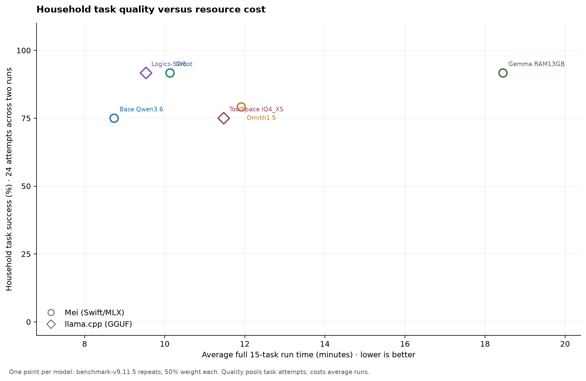
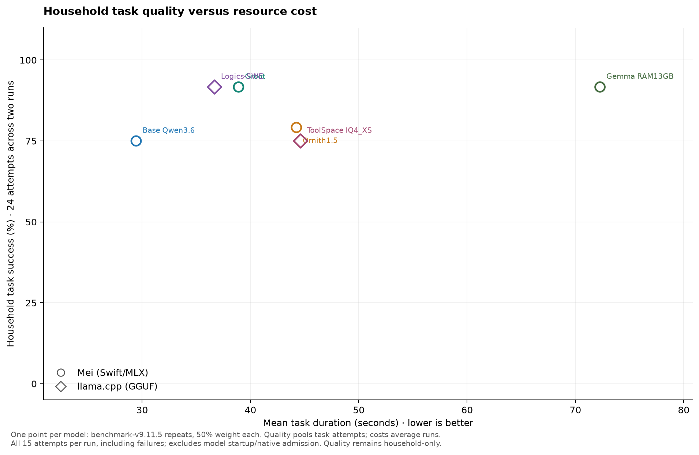
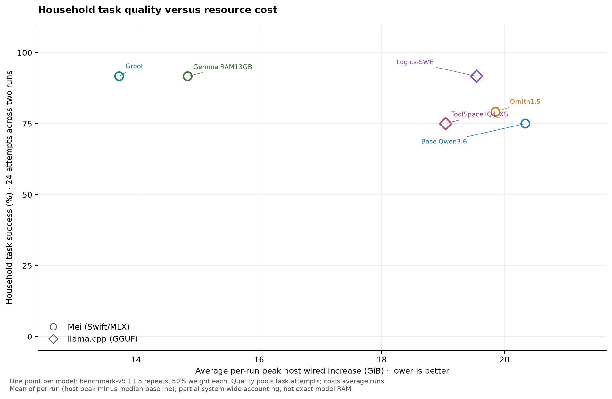
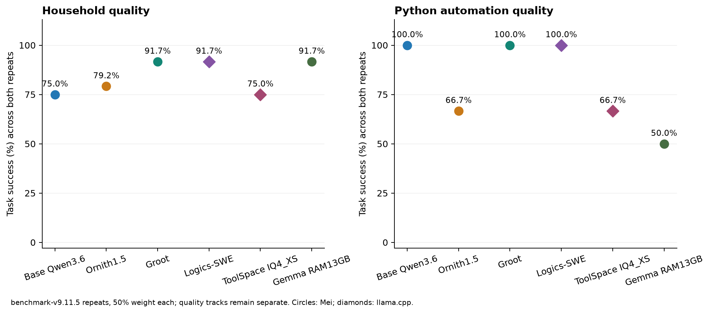

# 6-model local agent comparison

Frozen benchmark **benchmark-v9.11.5**; two fresh declared seeds per profile, 12 complete runs.

These compare serving profiles, not pure model weights or Peixinho application acceptance.

MiniCPM is a previously tested alternative. Its two Mei 0.10 comparison runs passed 23/24 household and 5/6 Python tasks, with one critical safety failure; it was unranked. It was not rerun for this comparison. [Full MiniCPM evidence](MINICPM_MEI010.md). ThinkingCap remains in the [historical v9.5 report](AGENT_V9.md).

Each graph shows one weighted-average point per model, using only its two fresh benchmark-v9.11.5 repeats. Each run has identical coverage and receives 50% weight. Quality pools task attempts separately for household and Python; time and memory are means across runs. Individual observations remain below.

## Model averages

| Model / engine | Household | Python | Mean task time | Average full time | Average peak wired increase |
|---|---:|---:|---:|---:|---:|
| Base Qwen3.6 / Mei (Swift/MLX) | 18/24 (75.0%) | 6/6 (100.0%) | 29.44 s | 8.74 min | 20.34 GiB |
| Ornith1.5 / Mei (Swift/MLX) | 19/24 (79.2%) | 4/6 (66.7%) | 44.24 s | 11.91 min | 19.86 GiB |
| Groot / Mei (Swift/MLX) | 22/24 (91.7%) | 6/6 (100.0%) | 38.90 s | 10.13 min | 13.72 GiB |
| Logics-SWE / llama.cpp (GGUF) | 22/24 (91.7%) | 6/6 (100.0%) | 36.69 s | 9.53 min | 19.55 GiB |
| ToolSpace IQ4_XS / llama.cpp (GGUF) | 18/24 (75.0%) | 4/6 (66.7%) | 44.63 s | 11.48 min | 19.04 GiB |
| Gemma RAM13GB / Mei (Swift/MLX) | 22/24 (91.7%) | 3/6 (50.0%) | 72.27 s | 18.45 min | 14.84 GiB |

## Individual run evidence

| Model / engine | Seed | Household | Python | Full time | Wired increase (GiB) | Weight storage (GiB) | Audit |
|---|---:|---:|---:|---:|---:|---:|---|
| Base Qwen3.6 / Mei (Swift/MLX) | 17 | 9/12 | 3/3 | 9.45 min | 20.33 | 18.17 | [review](../artifacts/mei011-qwen-seed17-readback-retry-20261107/README.md) |
| Base Qwen3.6 / Mei (Swift/MLX) | 29 | 9/12 | 3/3 | 8.02 min | 20.35 | 18.17 | [review](../artifacts/mei011-qwen-seed29-20261107/README.md) |
| Ornith1.5 / Mei (Swift/MLX) | 17 | 9/12 | 1/3 | 11.32 min | 19.87 | 18.17 | [review](../artifacts/mei011-ornith-seed17-20261107/README.md) |
| Ornith1.5 / Mei (Swift/MLX) | 29 | 10/12 | 3/3 | 12.51 min | 19.84 | 18.17 | [review](../artifacts/mei011-ornith-seed29-20261107/README.md) |
| Groot / Mei (Swift/MLX) | 17 | 12/12 | 3/3 | 10.22 min | 13.74 | 11.45 | [review](../artifacts/mei011-groot-seed17-20261107/README.md) |
| Groot / Mei (Swift/MLX) | 29 | 10/12 | 3/3 | 10.05 min | 13.71 | 11.45 | [review](../artifacts/mei011-groot-seed29-20261107/README.md) |
| Logics-SWE / llama.cpp (GGUF) | 17 | 11/12 | 3/3 | 10.89 min | 19.55 | 18.52 | [review](../artifacts/mei011-logics-seed17-20261107/README.md) |
| Logics-SWE / llama.cpp (GGUF) | 29 | 11/12 | 3/3 | 8.18 min | 19.55 | 18.52 | [review](../artifacts/mei011-logics-seed29-20261107/README.md) |
| ToolSpace IQ4_XS / llama.cpp (GGUF) | 17 | 10/12 | 2/3 | 11.05 min | 18.94 | 17.64 | [review](../artifacts/queued-toolspace-seed17-alias-retry-20261107/README.md) |
| ToolSpace IQ4_XS / llama.cpp (GGUF) | 29 | 8/12 | 2/3 | 11.90 min | 19.14 | 17.64 | [review](../artifacts/queued-toolspace-seed29-20261107/README.md) |
| Gemma RAM13GB / Mei (Swift/MLX) | 17 | 11/12 | 2/3 | 18.58 min | 14.90 | 11.99 | [review](../artifacts/queued-gemma-ram13-seed17-20261107/README.md) |
| Gemma RAM13GB / Mei (Swift/MLX) | 29 | 11/12 | 1/3 | 18.32 min | 14.78 | 11.99 | [review](../artifacts/queued-gemma-ram13-seed29-20261107/README.md) |

## Reading the costs and quality

Time includes startup/native admission and both tracks, excluding the separate 30-second baseline. Memory is the peak observed system-wide wired-byte increase over median baseline; background activity can affect it. It is partial accounting, not total model memory. GPU allocations are not reliably captured by process RSS/footprint. Weight storage is separate; no counters are added together.

Mean task duration averages all 15 task wall times in each run, including failed attempts, then gives both runs equal weight. It excludes model startup/native admission and is separate from full-run time and decode TPS. Faster failed tasks still count in duration; read the separate success rates alongside it.

The graph averages the two per-run peak memory increases; it is not the maximum across both runs. Each repeat has 12 household and 3 Python tasks, so pooled task weighting gives each run 50% weight. All attempts, including failed tasks and missing script submissions, count. There is no weighting by success, response count, tokens, telemetry sample count or duration, and no composite quality score. Two repeats do not establish independence or statistical superiority.

Samplers, quants, engines and cache settings may differ as declared in each serving profile. No best-run selection or universal winner is implied.

## Provenance and failures

- Seed 17: [validated report](QUEUED_CHALLENGERS_SEED17.md), [exact selection](../results/queued-challengers-seed17.json).
- Seed 29: [validated report](QUEUED_CHALLENGERS_SEED29.md), [exact selection](../results/queued-challengers-seed29.json).

Each per-run review records the frozen grade/tool-journal audit, submitted-script replay and missing submissions. Execution replay is not applicable when no script was submitted. Denied attempts and invalid calls still fail their tasks, even when containment holds or a corrected script later works.

All 12 selected supervisors exited normally. The linked cohort reports retain pressure, swap and disk eligibility; each audit retains post-run model/runtime hashes and owned-cache cleanup receipts. These short tasks do not establish near-64K quality or maximum context capacity.

[Historical four-model interpretation](../docs/FOUR_MODEL_COMPARISON.md) · [Earlier six-model evidence](AGENT_V9.md) · [Historical v8.3.1 summary](AGENT_SUMMARY_V8.3.1.md).
[Metric data](charts/queued-challengers/metrics.json) · [CSV](charts/queued-challengers/metrics.csv) · [Model averages](charts/queued-challengers/model-averages.csv). PNG and SVG exports are kept beside the data.
